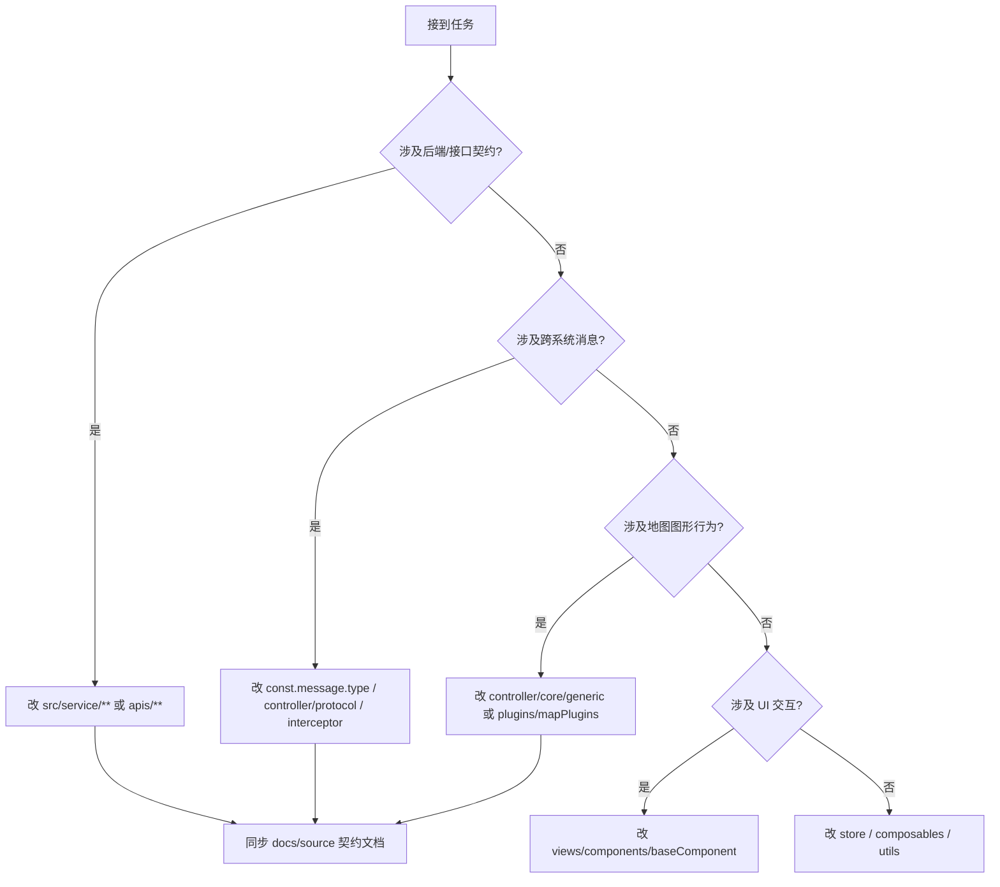

# AI 工作 SOP（ids-gis-web 专用）

> **核心规则**：本文件是 AI 在本仓库工作的**强制第一入口**。每次任务必须先读本文件，再读 `README.md`，然后按需进入各域文档。
> **事实来源**：本目录所有技术事实均从 `src/**`、`package.json`、`vite.config.ts`、`docs/source/**` 实测提取。事实与代码冲突时，**以代码为准**，并回写修正本目录。

---

## 一、工作启动流程（每次必做）

### 第 1 步：加载规范（强制）

```
读 herness/00-SOP.md          ← 你在这里（工作规范 + 质量门禁）
读 herness/README.md          ← 当前迭代状态 + 目录导航
```

### 第 2 步：定位任务域（按下方路由表）

本项目是**纯前端 GIS 工程**，没有后端代码。以下 5 类任务对应 5 条路径：

| 任务类型 | 走哪条路径 | 关键产出 | 必读文档 |
|---------|-----------|---------|---------|
| 需求/功能设计 | [01-产品设计/_流程规范.md](01-产品设计/_流程规范.md) | 需求分析、PRD | 05-共享上下文/核心概念术语.md |
| 编码/重构/修 Bug | [02-技术设计/_流程规范.md](02-技术设计/_流程规范.md) | 技术方案 + 代码 + 单元测试 | 05-共享上下文/设计规范速查.md |
| 测试/验收 | [03-测试/_流程规范.md](03-测试/_流程规范.md) | 测试策略、用例、报告 | 03-测试/_流程规范.md |
| 迭代/周计划 | [04-迭代管理/_index.md](04-迭代管理/_index.md) | 产物计划、产物汇总 | 04-迭代管理/_index.md |
| 代码审查 | [06-PR审查/_流程规范.md](06-PR审查/_流程规范.md) | 审查意见、问题闭环 | 06-PR审查/_流程规范.md |

### 第 3 步：读共享上下文（建立项目认知）

```
1. 05-共享上下文/项目结构速查.md      → 知道代码在哪、哪一层
2. 05-共享上下文/技术栈速查.md        → 知道用什么写的、怎么跑
3. 05-共享上下文/核心概念术语.md      → 知道业务在说什么
4. 05-共享上下文/设计规范速查.md      → 【编码前硬门禁】知道怎么写才对
5. 05-共享上下文/当前状态摘要.md      → 知道项目现在到哪了
6. 05-共享上下文/消息协议速查.md      → 涉及 WS/postMessage 时必读
```

### 第 4 步：执行 & 留痕

按对应流程执行，完成后在 [八、工作日志](#八工作日志) 追加记录；新增设计文档同步更新对应 `_index.md`。

---

## 二、核心行为规则

1. **先读后做**：不读 SOP 与 `05-共享上下文/设计规范速查.md` 就直接写代码 = 违规。
2. **先设计后编码**：任何编码任务前，必须先产出或确认技术方案（可简版，但必须有"涉及文件清单 + 关键流程"）。
3. **不臆造代码**：写文档、注释、PR 说明时引用代码必须给**真实路径与真实符号名**，禁止凭想象编造文件或行号。
4. **分层不越界**：架构强约束，见下方「二·分层铁律」，越层即违规。
5. **文档与代码同步**：实现与方案有偏差，必须回写 `02-技术设计/**`；禁止方案与代码长期背离。
6. **协议变更有流程**：改 `src/const/const.message.type.ts` 的事件键 / `src/controller/core/protocol/**` 的 DTO，必须同步 `docs/source/07-协议事件清单.md` 与 `docs/source/协议层DTO Schema.tsd`。
7. **自动生成文件禁改**：见 `05-共享上下文/设计规范速查.md`「自动生成文件」。
8. **PR 必须审查**：每个 MR 追加 AI 审查请求，问题闭环后才合入。
9. **验证后再宣称完成**：声称"完成/修复"前必须跑过 `pnpm lint` 或给出未验证的原因（`verification-before-completion`）。

---

## 三、分层铁律（越层即违规）

本项目采用**控制层分层架构**，见 `src/controller/**`。核心规则：

```
视图/组件  src/views/**、src/components/**
    ↓ 只读 store、只调 controller 公开方法，禁止直接碰 OL/ThreeJS 实例
状态层    src/store/**（Pinia）
    ↓ 业务状态、消息中枢（useMessageStore 是唯一消息总线）
控制器层  src/controller/**
    core/generic/    通用图形控制：view/geometry/spatial/kinematic —— 只执行图形指令，无业务语义
    core/business/   业务控制：alarm/call/dispatch/tracking/duty/config/addressRobot —— 只组装通用控制 DTO
    core/io/         输入输出控制：input/output
    core/protocol/   协议 DTO 定义：Generic/Business/IO 三份 interface 文件
    map/index.ts     地图系统对外发布订阅门面
    three/index.ts   三维系统对外发布订阅门面
    ↓
渲染底座  src/plugins/mapPlugins/**（MapCore + 插件）
    ↓
引擎      OpenLayers 10 / Three 0.169 / Cesium
```

| 规则 | 说明 |
|------|------|
| 通用控制层零业务 | `core/generic/**` 不得出现 alarm/call/dispatch 等业务词与业务状态 |
| 业务控制层不碰引擎 | `core/business/**` 不得 `import 'ol/...'` 或 `import 'three'` |
| DTO 唯一来源 | 控制器方法入参必须是 `core/protocol/**` 里的 interface，禁止用 `any` 承接跨层数据 |
| 跨系统通信唯一出口 | 所有 WS / postMessage 收发必须走 `useMessageStore().publish/subscribe`，禁止裸 `WebSocket`、禁止裸 `window.addEventListener('message')` |
| 新增控制器必须登记 | 新增 `XxxController` 必须同时在所属 `index.ts` 导出，并在 `05-共享上下文/项目结构速查.md` 补录 |

---

## 四、质量门禁

```
产品设计 ──→ 编码 ──→ 测试 ──→ MR
   │           │         │         │
   ▼           ▼         ▼         ▼
需求明确    方案+lint   用例通过   AI 审查通过
```

| 阶段 | 门禁条件（不满足不得进入下一阶段） |
|------|------|
| → 编码 | 技术方案已产出（涉及文件清单 + 关键流程 + 分层落点）；分层铁律确认无越层 |
| 编码中 | 每处改动能说清它落在 `store / controller / plugin / view` 哪一层、为什么 |
| 编码后 | `pnpm lint` **无新增**报错（基线约 193 个，见上） |
| → 测试 | 新增/变更逻辑有对应用例；`pnpm lint` 无新增报错 |
| → MR | 技术方案已回写；`docs/source/**` 若被影响已同步；MR 描述含变更概述与关联文档 |
| MR → 合入 | AI 审查通过；未修复问题已在 MR 评论说明原因 |

---

## 五、常用命令

```bash
pnpm dev                # 本地开发（mode=dev.local，端口 8888）
pnpm dev:local          # 同上（显式）
pnpm build              # 构建应用（dist/）
pnpm build:lib          # 库模式构建（dist-lib/，入口 src/lib/index.ts）
pnpm lint               # 类型检查：vue-tsc --noEmit（这是类型门禁，不是 ESLint）
pnpm mock:server        # 启动本地 mock 服务（node server/index.js）
pnpm mock:server:restart# 重启本地 mock
```

> ⚠️ **本项目无单元测试框架**（无 vitest/jest 依赖与 `test` 脚本）。`tests/**` 下是历史遗留的 `.test.ts` 脚本，需自备 runner 执行。
>
> ⚠️ **类型门禁基线不干净**：`pnpm lint` 当前约 **193 个既有报错**，绝大多数为 `TS6133`（未用变量/导入，源于 `noUnusedLocals`/`noUnusedParameters`），另有 **6 个 `TS2339/TS2551`** 是消息事件键缺失（真实缺陷）。
>
> **判定规则**：不要用"全局零报错"作为通过标准。应对比**改动前后**的报错数与文件范围，只对自己引入的新错误负责。详见 [05-共享上下文/当前状态摘要.md](05-共享上下文/当前状态摘要.md)。

---

## 六、任务路由决策



---

## 七、关联文件

| 文件 | 作用 |
|------|------|
| `README.md` | 目录导航 + 当前迭代状态 |
| `01-产品设计/_流程规范.md` | 需求设计工作流 |
| `02-技术设计/_流程规范.md` | 编码工作流 + 技术方案模板 |
| `03-测试/_流程规范.md` | 测试工作流 |
| `04-迭代管理/_index.md` | 迭代总览 |
| `05-共享上下文/*` | 技术栈/结构/术语/规范/协议速查 |
| `06-PR审查/_流程规范.md` | MR 审查工作流 |
| `examples/*` | 各阶段产物示例 |

---

## 八、工作日志

> **留痕规则**：每次完成工作后追加一条。格式 `| 时间 | 工作内容 | 变更文件 | 关联迭代 |`

| 时间 | 工作内容 | 变更文件 | 关联迭代 |
|------|---------|---------|---------|
| 2026-10-09 | 建立 herness 工作台（基于 herness-template 落地，注入本项目真实事实） | `herness/**` | — |
| 2026-10-09 | MarkDraw 页面优化：工具栏图标补齐（复用 map sprite）、绘图/量算工具改为复用 components/map/MapTools + useCardStore.setMapDrawTool、底图共用 OpenlayersMap 装配、清理 MarkDraw 内重复工具与 demo 废码 | src/components/MarkDraw/**、src/views/markDraw/index.vue | — |
| 2026-10-10 | 新增 useBroadcastChannel：参照 useWebSocket 的 WebSocketClient 结构实现 BroadcastChannelClient（构造即连接/send/sendEvent/disconnect/回调，无重连心跳、不自回发）；useMessageStore 增加 bindBroadcastChannel + bcClients + publish 分支 + disconnectSystem 清理；MESSAGE_CHANNEL 增加 broadcastChannel；register/initMessage 以 VITE_USE_BROADCAST_CHANNEL 开关同 bindParent 方式注册，并修复 dispose 未执行 cleanups 的泄漏 | src/hooks/useBroadcastChannel.ts、src/store/useMessageStore.ts、src/register/initMessage.ts、src/const/const.message.type.ts、src/config/env.ts、.env.*、herness/05-共享上下文/消息协议速查.md | — |
| 2026-10-10 | MarkDraw 第3轮：新增「清除元素」按钮（engine.clearFeatures + 数据源监听同步可用态）、量算/查询工具改为 MarkDraw 内部实现（tools/MeasureTools + tools/QueryTools）、修复量算图元无 id 导致清除漏删、视图面板三级改上下两段自适应排版、缩放控件下移至左下角、清理 sharedMapTools.ts 死码 | src/components/MarkDraw/**、src/views/markDraw/index.vue | — |
| 2026-10-10 | MarkDraw 第4轮：移除圈选查询 / 实时人口工具（含 QueryTools 内两工具、queryState 相关类型与事件、结果条查询分支），工具数 17→15；修复确认框溢出——改为 createApp 动态挂载 MdModal + Teleport to body，.md-modal* / .md-message* 样式从组件 scoped 提到全局 styles/toast.less，z-index 100001；要素列表列名改为跟随 WFS 返回的 properties（排除几何与空值列，常见业务字段优先，最多 5 列），加载失败时清空避免残留上个图层数据 | src/components/MarkDraw/** | — |
| 2026-10-10 | 产出《项目文件夹架构设计说明》：按 src/** 实测梳理五段式依赖流向、逐层目录职责（views/components、store、controller、baseComponent 与 plugins/mapPlugins、hooks/interceptor/register、service/apis、config/const、composables、router/layout、types/shims、styles/assets、utils/directives、lib 双形态）、横切约定（消息协议改一处改三处、订阅解耦、只经 appEnv、WGS84、lint 基线）、落位速查表、决策记录与 6 项已知架构债 | herness/02-技术设计/前端/项目文件夹架构设计说明.md、herness/02-技术设计/前端/_index.md | — |
| 2026-10-10 | MarkDraw 第5轮：修复选中图层后图层列表清空——setActiveLayer 用 id.split(':')[0] 推分组（gis）但真实 groupId 是 dispatch，导致分组失配；改为不推导并加 safeGroupId 兜底；新增 utils/layerStyle.ts 按几何类型+图层语义上图（围栏虚线 / 有 icon 用图标化点位 / 无 icon 用默认样式），接入 engine.addFeature 与 importGeoJSON；修复 geometryToLngLat 只处理两层嵌套导致 MultiPolygon 全变 null，改为递归并新增 CoordArray 类型 | src/components/MarkDraw/** | — |
| 2026-10-11 | MarkDraw 第6轮：修复切换图层要素累积上图——原逻辑只删同 layer 旧要素，换图层时旧图层要素全部留在图上；改为用 renderedLayerId 记录已上图图层，加载新图层时把上一个图层要素整体 removeFeatures 下掉（只按 layerId 过滤，业务标绘层要素不受影响） | src/components/MarkDraw/view/FeatureListPanel.vue | — |
| 2026-10-12 | 产出《circleQueryPanel 改造 + 路径规划面板技术方案》：input-panel 检索框（高德地址 + GIS 资源双数据源、视图下拉取 LAYER_SOURCE_CONFIGS 的 name/id、结果 tab 回显、关注点特效 fit）、圈选联动与模糊+视口双模式 1 万条上限、路径规划独立面板（小汽车/货车 tab、地图选点、el-autocomplete、实时/手动分析、上图 fit）、GCJ-02↔WGS84 坐标风险与 7 项风险/5 项待确认 | herness/02-技术设计/前端/circleQueryPanel改造-技术方案.md、herness/02-技术设计/前端/_index.md | — |
| 2026-10-12 | MarkDraw 第7轮：新增 engine/MarkDrawHighlight.ts 选中高亮器——独立高亮图层（zIndex 90、hitDetection 置空不遮挡交互）+ 发光外扩描边 + 白色内描边 + 半透明填充 + 面/线中心菱形标记 / 点位光晕双圆；requestAnimationFrame 三角波驱动 3 次闪烁后回落静态高亮；接入 selectById、SelectInteraction onSelect、removeFeature(s)、clearFeatures、destroy 全部 8 处选中出口 | src/components/MarkDraw/engine/MarkDrawHighlight.ts、src/components/MarkDraw/engine/createMarkDrawEngine.ts | — |
| 2026-10-12 | amap.ts 对齐新版接口文档：regeo 改 poiType/去 batch、响应改 GeoJSON FeatureCollection；analyzeAddress 补 city 并改全灾害指令结构；aroundSearch 改 sortRule 补 city；drivingV2 改 walk/load/height/width；multiWaypoint 改 destinations 重复传参；同步 AmapApiDemo.vue。circleQueryPanel 方案按反馈定稿 D5~D7（POI 已 WGS84 不转换、暂不做联动、name 仅展示 id 为准） | src/apis/amap.ts、src/views/amap/AmapApiDemo.vue、herness/02-技术设计/前端/circleQueryPanel改造-技术方案.md | — |
| 2026-10-12 | circleQueryPanel 方案按反馈二次定稿：视图下拉选中 → 展开面板 + 自动重查该 id 图层 + 切资源 tab（D6）；模糊字段不探查统一用 name（Q2）；视口过滤后 1 万条直接上图不采样（Q4）；两面板互斥折叠（Q5）；同步修正 D3/R1/R3/R4/R5 与验证清单、lint 基线 | herness/02-技术设计/前端/circleQueryPanel改造-技术方案.md | — |
| 2026-10-12 | circleQueryPanel 方案按反馈三次定稿（Q4 上图策略）：资源上图改为 **WMS 服务端出图**（沿用 CircleQueryTool 的 ImageLayer+ImageWMS+CQL_FILTER 模式，服务端渲染不受条数影响），WFS 仅回显列表（maxFeatures=10000 只约束列表），点击列表项用前端单点聚焦特效+flyTo；新增 §6.2 WMS 参数规格（CQL_FILTER 与 LAYERS 按序一一对应、同源同一 CQL、updateParams 不重建、1=0 空图、ratio/zIndex） | herness/02-技术设计/前端/circleQueryPanel改造-技术方案.md | — |
| 2026-10-12 | circleQueryPanel 改造 + 路径规划面板落地：新增 types/search（检索/路径 DTO）、service/searchQuery（CQL 构造 + 高德地址 WFS 资源双源编排、1 万条上限）、store/useSearchPanelStore（面板互斥折叠、路径表单与 session 历史）、MapTools/drawMapTools/SearchResultTool（WMS 资源出图 + 前端少量点位/路径/聚焦脉冲）；重写 component/circleQueryPanel（input-panel 前缀路径规划图标 + 视图下拉 + 双 tab 列表 + 圈选半径/类型/统计保留，圈选 DWITHIN 与 WMS/WFS 同源）；新增 component/routePlanPanel（小汽车/货车 tab、地图选点、el-autocomplete 模糊、实时/手动分析、历史记忆、fit 上图）；挂载到 map/index 与 DrawMap/index；视口 BBOX 改走 ol/proj transform 统一投影。校验：pnpm lint 196（与基线一致，新增/改动文件 0 报错）、pnpm build 通过 | src/types/search.ts、src/service/searchQuery.ts、src/store/useSearchPanelStore.ts、src/components/map/MapTools/drawMapTools/SearchResultTool.ts、src/components/map/component/circleQueryPanel.vue、src/components/map/component/routePlanPanel.vue、src/components/map/index.vue、src/components/DrawMap/index.vue、src/baseComponent/OpenlayersMap/layers.ts、src/store/index.ts | — |
| 2026-10-12 | 修复检索/路径规划面板运行期阻塞：`MapStore.map` 初值是 `{}`（truthy 但无 addLayer），导致 `SearchResultTool` 构造时报 `this.map.addLayer is not a function`。utils/mapTool 新增 `isOlMap()` 守卫；SearchResultTool 构造期强校验 + 新增 getMap() 供调用方比对实例；circleQueryPanel/routePlanPanel 的 ensureTool 改为 isOlMap 判定并在地图实例被替换时 destroy 重建；routePlanPanel onMounted 预热改为地图就绪 watch 兜底、onBeforeUnmount 改 destroy 释放图层；SearchResultTool.destroy 改幂等。顺带修复 useAmapTools 两处 multiWaypoint 调用未跟随 destinations 签名变更导致的 TS2561 | src/utils/mapTool.ts、src/components/map/MapTools/drawMapTools/SearchResultTool.ts、src/components/map/component/circleQueryPanel.vue、src/components/map/component/routePlanPanel.vue、src/baseComponent/amap/useAmapTools.ts | — |
| 2026-10-12 | MarkDraw 第9轮：坐标系口径统一 —— 全链路只保留 4326（展示/落库）与 3857（地图内部），转换收敛到 readGeoJsonAsMercator 与 wfsXml 两个边界；修 wfsXml 三处数据流转缺陷（writeTransaction 第4参缺 featureNS 导致 undefined.startsWith、返回 DOM Node 被当 JSON 发出、写副本几何名须用 DescribeFeatureType 真名 zone_geom）；srsName 由 EPSG:4326 改 CRS:84（OL 里 EPSG:4326 轴序 neu 会二次倒序导致 PointOutsideEnvelopeException）；围栏贴边吸附/交叠校验改在 4326 上运算并删掉自制地球换算公式；解除 gis:view_juris_zone 只读拦截（服务端仍返回 read-only，需管理员放开 GeoServer 图层写权限）；新增保存按钮变更指纹快照，无变更直接置灰。校验：pnpm build 通过、pnpm lint 中 MarkDraw 目录 0 报错 | src/components/MarkDraw/** | — |
