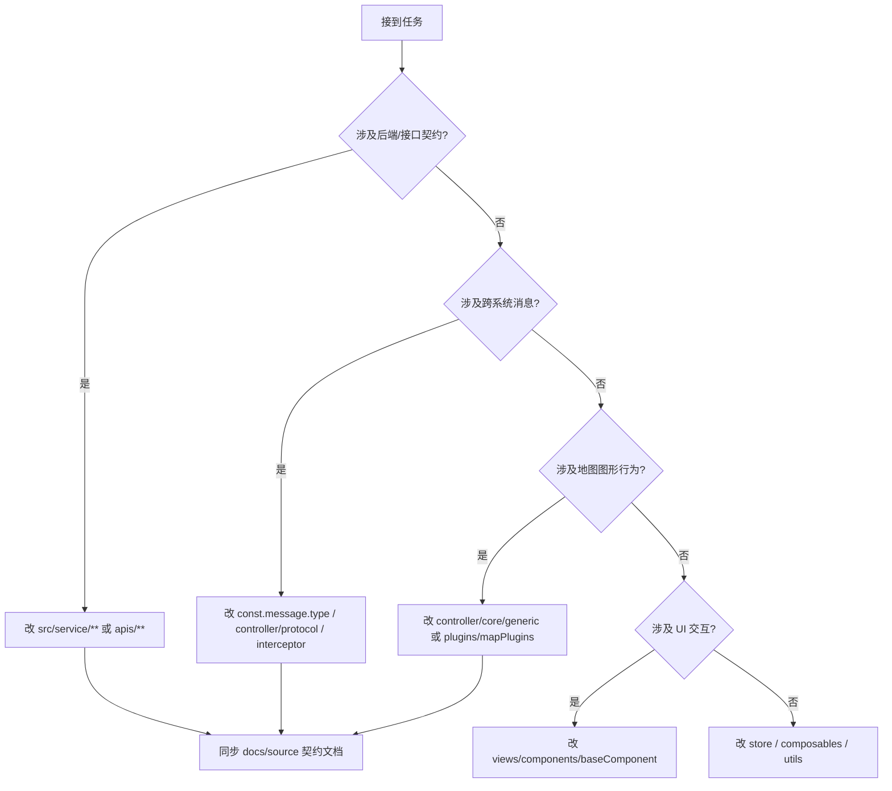

# AI 工作 SOP（ids-gis-web 专用）

> **核心规则**：本文件是 AI 在本仓库工作的**强制第一入口**。每次任务必须先读本文件，再读 `README.md`，然后按需进入各域文档。
> **事实来源**：本目录所有技术事实均从 `src/**`、`package.json`、`vite.config.ts`、`docs/source/**` 实测提取。事实与代码冲突时，**以代码为准**，并回写修正本目录。

---

## 一、工作启动流程（每次必做）

### 第 1 步：加载规范（强制）

```
读 herness/00-SOP.md          ← 你在这里（工作规范 + 质量门禁）
读 herness/README.md          ← 当前迭代状态 + 目录导航
```

### 第 2 步：定位任务域（按下方路由表）

本项目是**纯前端 GIS 工程**，没有后端代码。以下 5 类任务对应 5 条路径：

| 任务类型 | 走哪条路径 | 关键产出 | 必读文档 |
|---------|-----------|---------|---------|
| 需求/功能设计 | [01-产品设计/_流程规范.md](01-产品设计/_流程规范.md) | 需求分析、PRD | 05-共享上下文/核心概念术语.md |
| 编码/重构/修 Bug | [02-技术设计/_流程规范.md](02-技术设计/_流程规范.md) | 技术方案 + 代码 + 单元测试 | 05-共享上下文/设计规范速查.md |
| 测试/验收 | [03-测试/_流程规范.md](03-测试/_流程规范.md) | 测试策略、用例、报告 | 03-测试/_流程规范.md |
| 迭代/周计划 | [04-迭代管理/_index.md](04-迭代管理/_index.md) | 产物计划、产物汇总 | 04-迭代管理/_index.md |
| 代码审查 | [06-PR审查/_流程规范.md](06-PR审查/_流程规范.md) | 审查意见、问题闭环 | 06-PR审查/_流程规范.md |

### 第 3 步：读共享上下文（建立项目认知）

```
1. 05-共享上下文/项目结构速查.md      → 知道代码在哪、哪一层
2. 05-共享上下文/技术栈速查.md        → 知道用什么写的、怎么跑
3. 05-共享上下文/核心概念术语.md      → 知道业务在说什么
4. 05-共享上下文/设计规范速查.md      → 【编码前硬门禁】知道怎么写才对
5. 05-共享上下文/当前状态摘要.md      → 知道项目现在到哪了
6. 05-共享上下文/消息协议速查.md      → 涉及 WS/postMessage 时必读
```

### 第 4 步：执行 & 留痕

按对应流程执行，完成后在 [八、工作日志](#八工作日志) 追加记录；新增设计文档同步更新对应 `_index.md`。

---

## 二、核心行为规则

1. **先读后做**：不读 SOP 与 `05-共享上下文/设计规范速查.md` 就直接写代码 = 违规。
2. **先设计后编码**：任何编码任务前，必须先产出或确认技术方案（可简版，但必须有"涉及文件清单 + 关键流程"）。
3. **不臆造代码**：写文档、注释、PR 说明时引用代码必须给**真实路径与真实符号名**，禁止凭想象编造文件或行号。
4. **分层不越界**：架构强约束，见下方「二·分层铁律」，越层即违规。
5. **文档与代码同步**：实现与方案有偏差，必须回写 `02-技术设计/**`；禁止方案与代码长期背离。
6. **协议变更有流程**：改 `src/const/const.message.type.ts` 的事件键 / `src/controller/core/protocol/**` 的 DTO，必须同步 `docs/source/07-协议事件清单.md` 与 `docs/source/协议层DTO Schema.tsd`。
7. **自动生成文件禁改**：见 `05-共享上下文/设计规范速查.md`「自动生成文件」。
8. **PR 必须审查**：每个 MR 追加 AI 审查请求，问题闭环后才合入。
9. **验证后再宣称完成**：声称"完成/修复"前必须跑过 `pnpm lint` 或给出未验证的原因（`verification-before-completion`）。

---

## 三、分层铁律（越层即违规）

本项目采用**控制层分层架构**，见 `src/controller/**`。核心规则：

```
视图/组件  src/views/**、src/components/**
    ↓ 只读 store、只调 controller 公开方法，禁止直接碰 OL/ThreeJS 实例
状态层    src/store/**（Pinia）
    ↓ 业务状态、消息中枢（useMessageStore 是唯一消息总线）
控制器层  src/controller/**
    core/generic/    通用图形控制：view/geometry/spatial/kinematic —— 只执行图形指令，无业务语义
    core/business/   业务控制：alarm/call/dispatch/tracking/duty/config/addressRobot —— 只组装通用控制 DTO
    core/io/         输入输出控制：input/output
    core/protocol/   协议 DTO 定义：Generic/Business/IO 三份 interface 文件
    map/index.ts     地图系统对外发布订阅门面
    three/index.ts   三维系统对外发布订阅门面
    ↓
渲染底座  src/plugins/mapPlugins/**（MapCore + 插件）
    ↓
引擎      OpenLayers 10 / Three 0.169 / Cesium
```

| 规则 | 说明 |
|------|------|
| 通用控制层零业务 | `core/generic/**` 不得出现 alarm/call/dispatch 等业务词与业务状态 |
| 业务控制层不碰引擎 | `core/business/**` 不得 `import 'ol/...'` 或 `import 'three'` |
| DTO 唯一来源 | 控制器方法入参必须是 `core/protocol/**` 里的 interface，禁止用 `any` 承接跨层数据 |
| 跨系统通信唯一出口 | 所有 WS / postMessage 收发必须走 `useMessageStore().publish/subscribe`，禁止裸 `WebSocket`、禁止裸 `window.addEventListener('message')` |
| 新增控制器必须登记 | 新增 `XxxController` 必须同时在所属 `index.ts` 导出，并在 `05-共享上下文/项目结构速查.md` 补录 |

---

## 四、质量门禁

```
产品设计 ──→ 编码 ──→ 测试 ──→ MR
   │           │         │         │
   ▼           ▼         ▼         ▼
需求明确    方案+lint   用例通过   AI 审查通过
```

| 阶段 | 门禁条件（不满足不得进入下一阶段） |
|------|------|
| → 编码 | 技术方案已产出（涉及文件清单 + 关键流程 + 分层落点）；分层铁律确认无越层 |
| 编码中 | 每处改动能说清它落在 `store / controller / plugin / view` 哪一层、为什么 |
| 编码后 | `pnpm lint` **无新增**报错（基线约 193 个，见上） |
| → 测试 | 新增/变更逻辑有对应用例；`pnpm lint` 无新增报错 |
| → MR | 技术方案已回写；`docs/source/**` 若被影响已同步；MR 描述含变更概述与关联文档 |
| MR → 合入 | AI 审查通过；未修复问题已在 MR 评论说明原因 |

---

## 五、常用命令

```bash
pnpm dev                # 本地开发（mode=dev.local，端口 8888）
pnpm dev:local          # 同上（显式）
pnpm build              # 构建应用（dist/）
pnpm build:lib          # 库模式构建（dist-lib/，入口 src/lib/index.ts）
pnpm lint               # 类型检查：vue-tsc --noEmit（这是类型门禁，不是 ESLint）
pnpm mock:server        # 启动本地 mock 服务（node server/index.js）
pnpm mock:server:restart# 重启本地 mock
```

> ⚠️ **本项目无单元测试框架**（无 vitest/jest 依赖与 `test` 脚本）。`tests/**` 下是历史遗留的 `.test.ts` 脚本，需自备 runner 执行。
>
> ⚠️ **类型门禁基线不干净**：`pnpm lint` 当前约 **193 个既有报错**，绝大多数为 `TS6133`（未用变量/导入，源于 `noUnusedLocals`/`noUnusedParameters`），另有 **6 个 `TS2339/TS2551`** 是消息事件键缺失（真实缺陷）。
>
> **判定规则**：不要用"全局零报错"作为通过标准。应对比**改动前后**的报错数与文件范围，只对自己引入的新错误负责。详见 [05-共享上下文/当前状态摘要.md](05-共享上下文/当前状态摘要.md)。

---

## 六、任务路由决策



---

## 七、关联文件

| 文件 | 作用 |
|------|------|
| `README.md` | 目录导航 + 当前迭代状态 |
| `01-产品设计/_流程规范.md` | 需求设计工作流 |
| `02-技术设计/_流程规范.md` | 编码工作流 + 技术方案模板 |
| `03-测试/_流程规范.md` | 测试工作流 |
| `04-迭代管理/_index.md` | 迭代总览 |
| `05-共享上下文/*` | 技术栈/结构/术语/规范/协议速查 |
| `06-PR审查/_流程规范.md` | MR 审查工作流 |
| `examples/*` | 各阶段产物示例 |

---

## 八、工作日志

> **留痕规则**：每次完成工作后追加一条。格式 `| 时间 | 工作内容 | 变更文件 | 关联迭代 |`

| 时间 | 工作内容 | 变更文件 | 关联迭代 |
|------|---------|---------|---------|
| 2026-10-09 | 建立 herness 工作台（基于 herness-template 落地，注入本项目真实事实） | `herness/**` | — |
| 2026-10-09 | MarkDraw 页面优化：工具栏图标补齐（复用 map sprite）、绘图/量算工具改为复用 components/map/MapTools + useCardStore.setMapDrawTool、底图共用 OpenlayersMap 装配、清理 MarkDraw 内重复工具与 demo 废码 | src/components/MarkDraw/**、src/views/markDraw/index.vue | — |
| 2026-10-10 | 新增 useBroadcastChannel：参照 useWebSocket 的 WebSocketClient 结构实现 BroadcastChannelClient（构造即连接/send/sendEvent/disconnect/回调，无重连心跳、不自回发）；useMessageStore 增加 bindBroadcastChannel + bcClients + publish 分支 + disconnectSystem 清理；MESSAGE_CHANNEL 增加 broadcastChannel；register/initMessage 以 VITE_USE_BROADCAST_CHANNEL 开关同 bindParent 方式注册，并修复 dispose 未执行 cleanups 的泄漏 | src/hooks/useBroadcastChannel.ts、src/store/useMessageStore.ts、src/register/initMessage.ts、src/const/const.message.type.ts、src/config/env.ts、.env.*、herness/05-共享上下文/消息协议速查.md | — |
| 2026-10-10 | MarkDraw 第3轮：新增「清除元素」按钮（engine.clearFeatures + 数据源监听同步可用态）、量算/查询工具改为 MarkDraw 内部实现（tools/MeasureTools + tools/QueryTools）、修复量算图元无 id 导致清除漏删、视图面板三级改上下两段自适应排版、缩放控件下移至左下角、清理 sharedMapTools.ts 死码 | src/components/MarkDraw/**、src/views/markDraw/index.vue | — |
| 2026-10-10 | MarkDraw 第4轮：移除圈选查询 / 实时人口工具（含 QueryTools 内两工具、queryState 相关类型与事件、结果条查询分支），工具数 17→15；修复确认框溢出——改为 createApp 动态挂载 MdModal + Teleport to body，.md-modal* / .md-message* 样式从组件 scoped 提到全局 styles/toast.less，z-index 100001；要素列表列名改为跟随 WFS 返回的 properties（排除几何与空值列，常见业务字段优先，最多 5 列），加载失败时清空避免残留上个图层数据 | src/components/MarkDraw/** | — |
| 2026-10-10 | 产出《项目文件夹架构设计说明》：按 src/** 实测梳理五段式依赖流向、逐层目录职责（views/components、store、controller、baseComponent 与 plugins/mapPlugins、hooks/interceptor/register、service/apis、config/const、composables、router/layout、types/shims、styles/assets、utils/directives、lib 双形态）、横切约定（消息协议改一处改三处、订阅解耦、只经 appEnv、WGS84、lint 基线）、落位速查表、决策记录与 6 项已知架构债 | herness/02-技术设计/前端/项目文件夹架构设计说明.md、herness/02-技术设计/前端/_index.md | — |
| 2026-10-10 | MarkDraw 第5轮：修复选中图层后图层列表清空——setActiveLayer 用 id.split(':')[0] 推分组（gis）但真实 groupId 是 dispatch，导致分组失配；改为不推导并加 safeGroupId 兜底；新增 utils/layerStyle.ts 按几何类型+图层语义上图（围栏虚线 / 有 icon 用图标化点位 / 无 icon 用默认样式），接入 engine.addFeature 与 importGeoJSON；修复 geometryToLngLat 只处理两层嵌套导致 MultiPolygon 全变 null，改为递归并新增 CoordArray 类型 | src/components/MarkDraw/** | — |
| 2026-10-11 | MarkDraw 第6轮：修复切换图层要素累积上图——原逻辑只删同 layer 旧要素，换图层时旧图层要素全部留在图上；改为用 renderedLayerId 记录已上图图层，加载新图层时把上一个图层要素整体 removeFeatures 下掉（只按 layerId 过滤，业务标绘层要素不受影响） | src/components/MarkDraw/view/FeatureListPanel.vue | — |
| 2026-10-12 | 产出《circleQueryPanel 改造 + 路径规划面板技术方案》：input-panel 检索框（高德地址 + GIS 资源双数据源、视图下拉取 LAYER_SOURCE_CONFIGS 的 name/id、结果 tab 回显、关注点特效 fit）、圈选联动与模糊+视口双模式 1 万条上限、路径规划独立面板（小汽车/货车 tab、地图选点、el-autocomplete、实时/手动分析、上图 fit）、GCJ-02↔WGS84 坐标风险与 7 项风险/5 项待确认 | herness/02-技术设计/前端/circleQueryPanel改造-技术方案.md、herness/02-技术设计/前端/_index.md | — |
| 2026-10-12 | MarkDraw 第7轮：新增 engine/MarkDrawHighlight.ts 选中高亮器——独立高亮图层（zIndex 90、hitDetection 置空不遮挡交互）+ 发光外扩描边 + 白色内描边 + 半透明填充 + 面/线中心菱形标记 / 点位光晕双圆；requestAnimationFrame 三角波驱动 3 次闪烁后回落静态高亮；接入 selectById、SelectInteraction onSelect、removeFeature(s)、clearFeatures、destroy 全部 8 处选中出口 | src/components/MarkDraw/engine/MarkDrawHighlight.ts、src/components/MarkDraw/engine/createMarkDrawEngine.ts | — |
| 2026-10-12 | amap.ts 对齐新版接口文档：regeo 改 poiType/去 batch、响应改 GeoJSON FeatureCollection；analyzeAddress 补 city 并改全灾害指令结构；aroundSearch 改 sortRule 补 city；drivingV2 改 walk/load/height/width；multiWaypoint 改 destinations 重复传参；同步 AmapApiDemo.vue。circleQueryPanel 方案按反馈定稿 D5~D7（POI 已 WGS84 不转换、暂不做联动、name 仅展示 id 为准） | src/apis/amap.ts、src/views/amap/AmapApiDemo.vue、herness/02-技术设计/前端/circleQueryPanel改造-技术方案.md | — |
| 2026-10-12 | circleQueryPanel 方案按反馈二次定稿：视图下拉选中 → 展开面板 + 自动重查该 id 图层 + 切资源 tab（D6）；模糊字段不探查统一用 name（Q2）；视口过滤后 1 万条直接上图不采样（Q4）；两面板互斥折叠（Q5）；同步修正 D3/R1/R3/R4/R5 与验证清单、lint 基线 | herness/02-技术设计/前端/circleQueryPanel改造-技术方案.md | — |
| 2026-10-12 | circleQueryPanel 方案按反馈三次定稿（Q4 上图策略）：资源上图改为 **WMS 服务端出图**（沿用 CircleQueryTool 的 ImageLayer+ImageWMS+CQL_FILTER 模式，服务端渲染不受条数影响），WFS 仅回显列表（maxFeatures=10000 只约束列表），点击列表项用前端单点聚焦特效+flyTo；新增 §6.2 WMS 参数规格（CQL_FILTER 与 LAYERS 按序一一对应、同源同一 CQL、updateParams 不重建、1=0 空图、ratio/zIndex） | herness/02-技术设计/前端/circleQueryPanel改造-技术方案.md | — |
| 2026-10-12 | circleQueryPanel 改造 + 路径规划面板落地：新增 types/search（检索/路径 DTO）、service/searchQuery（CQL 构造 + 高德地址 WFS 资源双源编排、1 万条上限）、store/useSearchPanelStore（面板互斥折叠、路径表单与 session 历史）、MapTools/drawMapTools/SearchResultTool（WMS 资源出图 + 前端少量点位/路径/聚焦脉冲）；重写 component/circleQueryPanel（input-panel 前缀路径规划图标 + 视图下拉 + 双 tab 列表 + 圈选半径/类型/统计保留，圈选 DWITHIN 与 WMS/WFS 同源）；新增 component/routePlanPanel（小汽车/货车 tab、地图选点、el-autocomplete 模糊、实时/手动分析、历史记忆、fit 上图）；挂载到 map/index 与 DrawMap/index；视口 BBOX 改走 ol/proj transform 统一投影。校验：pnpm lint 196（与基线一致，新增/改动文件 0 报错）、pnpm build 通过 | src/types/search.ts、src/service/searchQuery.ts、src/store/useSearchPanelStore.ts、src/components/map/MapTools/drawMapTools/SearchResultTool.ts、src/components/map/component/circleQueryPanel.vue、src/components/map/component/routePlanPanel.vue、src/components/map/index.vue、src/components/DrawMap/index.vue、src/baseComponent/OpenlayersMap/layers.ts、src/store/index.ts | — |
| 2026-10-12 | 修复检索/路径规划面板运行期阻塞：`MapStore.map` 初值是 `{}`（truthy 但无 addLayer），导致 `SearchResultTool` 构造时报 `this.map.addLayer is not a function`。utils/mapTool 新增 `isOlMap()` 守卫；SearchResultTool 构造期强校验 + 新增 getMap() 供调用方比对实例；circleQueryPanel/routePlanPanel 的 ensureTool 改为 isOlMap 判定并在地图实例被替换时 destroy 重建；routePlanPanel onMounted 预热改为地图就绪 watch 兜底、onBeforeUnmount 改 destroy 释放图层；SearchResultTool.destroy 改幂等。顺带修复 useAmapTools 两处 multiWaypoint 调用未跟随 destinations 签名变更导致的 TS2561 | src/utils/mapTool.ts、src/components/map/MapTools/drawMapTools/SearchResultTool.ts、src/components/map/component/circleQueryPanel.vue、src/components/map/component/routePlanPanel.vue、src/baseComponent/amap/useAmapTools.ts | — |
| 2026-10-12 | MarkDraw 第9轮：坐标系口径统一 —— 全链路只保留 4326（展示/落库）与 3857（地图内部），转换收敛到 readGeoJsonAsMercator 与 wfsXml 两个边界；修 wfsXml 三处数据流转缺陷（writeTransaction 第4参缺 featureNS 导致 undefined.startsWith、返回 DOM Node 被当 JSON 发出、写副本几何名须用 DescribeFeatureType 真名 zone_geom）；srsName 由 EPSG:4326 改 CRS:84（OL 里 EPSG:4326 轴序 neu 会二次倒序导致 PointOutsideEnvelopeException）；围栏贴边吸附/交叠校验改在 4326 上运算并删掉自制地球换算公式；解除 gis:view_juris_zone 只读拦截（服务端仍返回 read-only，需管理员放开 GeoServer 图层写权限）；新增保存按钮变更指纹快照，无变更直接置灰。校验：pnpm build 通过、pnpm lint 中 MarkDraw 目录 0 报错 | src/components/MarkDraw/** | — |
| 2026-10-12 | MarkDraw 第10轮：修复地图编辑后维护表单不实时同步 + 保存按钮不释放。根因：MarkDrawSurface 只在 `selection:change` 重建 `selected`，`feature:modified` 不重建 —— MarkDrawFeature 里的 geometryLngLat 是选中那刻的快照，对象引用不变导致表单 watch 完全不触发。新增：`feature:modified` 时按 id 重建 selected；表单用 `sameFeature`（loadedId 比对）区分「换要素」与「同一要素几何刷新」，后者只刷几何文本与几何基线，不覆盖用户正在输入的属性；属性与几何基线拆分（attrSnapshot 只含属性，baselineGeom + mapGeomDirty 单独表达几何脏），避免地图拖拽导致基线漂移、canSave 恒为 true；移除 syncGeomFromMap 的 geomTouched 冻结分支（地图几何是唯一真相源）；Modify 加 pixelTolerance:10 让围栏顶点可抓。校验：pnpm build 通过、pnpm lint 中 MarkDraw 0 报错、浏览器实测属性改动/改回、放弃几何改动后按钮置灰均正确 | src/components/MarkDraw/components/MarkDrawSurface.vue、src/components/MarkDraw/form/FeatureEditorPanel.vue、src/components/MarkDraw/engine/MarkDrawSelectInteraction.ts | — |

| 2026-10-12 | circleQueryPanel 10 项反馈落地：①input-panel 去掉折叠/显示隐藏逻辑改为常驻，折叠与关闭按钮只留在 cq-panel 与 route-plan-panel，两者可同时打开、点输入框只展开 cq-panel；②新增 src/utils/themeColor.ts（cssVar/getThemeName/isNightTheme/themeAccent/withAlpha）与 src/styles/themed-panel.less（Element Plus 主题覆盖：tabs 文本色/激活条、input、button primary、checkbox、slider、空态，夜间下拉建议面板同步）；③panel 内硬编码色全部替换为 --accent-* / --text-primary / --widget-bg 等主题变量；④useCommonStore 默认主题 DAY→NIGHT 且 setThemeColor 同步 documentElement data-theme；⑤搜索半径/设施类型/统计已由 v-if="visible"（圈选工具激活）门控；⑥非圈选时 onQuery 取 getViewportExtent 走「视口+文本模糊」；⑦移除小汽车规划按钮（选终点即触发），新增 rp-status 状态区；⑧新增 routePlanPanel/routePlanPanel store 折叠态 + 折叠按钮；⑨端点上图独立 endpointLayer 修复 showRouteEndpoints 清空路径线的根因，showRouteEndpoints 用 start/end svg 图标 + fitPoints 实现「选起点移图、选终点两点 fit」；⑩CircleQueryTool 静态 persistedCircle 保存圆心半径，init 命中时 restorePersistedCircle 恢复并挂 Modify 实现二次点击拖拽改半径，新增 clearCircle() 与「清空圈选」按钮。校验：pnpm lint 193（与基线一致，改动文件 0 新增）、pnpm build ✓ | src/utils/themeColor.ts、src/styles/themed-panel.less、src/styles/index.less、src/store/useCommonStore.ts、src/store/useSearchPanelStore.ts、src/baseComponent/OpenlayersMap/layers.ts、src/components/map/MapTools/drawMapTools/SearchResultTool.ts、src/components/map/MapTools/drawMapTools/CircleQueryTool.ts、src/components/map/component/circleQueryPanel.vue、src/components/map/component/routePlanPanel.vue | — |
| 2026-10-13 | 修复 input-panel 需点圈选工具才出现：`circleQueryPanel` 原被 `v-if="type == PANEL_TYPES.CIRCLE_QUERY"` 门控（`type` 仅在圈选工具激活时写入），改为 map/index.vue 与 DrawMap/index.vue 无条件挂载；`searchPanelCollapsed` 初值 false→true 使 cq-panel 初始折叠，点输入框才展开，避免刷新页面即弹出空结果面板；清理 DrawMap 中随之失效的 `PANEL_TYPES` 导入与 `type` 解构。校验：pnpm lint 193（与基线一致）、pnpm build ✓ | src/components/map/index.vue、src/components/DrawMap/index.vue、src/store/useSearchPanelStore.ts | — |
| 2026-10-13 | 修复检索聚焦特效持续闪烁：根因是 SearchResultTool.startPulse 监听 focusLayer 的 postrender 事件并在每帧调用 feature.setStyle()，触发 source 变更引发新一轮渲染，形成「渲染→样式变更→重渲染」反馈循环，导致地图内所有覆盖物跟着一闪一闪，且无结束条件永不停止。改为 30fps setInterval 定时器驱动、只播放 1 秒（2 个完整脉冲），结束后落定为半径 12、透明度 0.28 的固定淡半透明聚焦圈并停表；同时移除 focusLayer 的 updateWhileAnimating / updateWhileInteracting 配置，避免动画/交互期间强制整层重绘。校验：pnpm lint 193（与基线一致）、pnpm build ✓ | src/components/map/MapTools/drawMapTools/SearchResultTool.ts | — |
| 2026-10-13 | 检索/路径规划面板 6 项交互修复：①onQuery 与 onToggleRoute 都先置 viewSelectVisible=false，点查询按钮与路径规划图标后视图下拉自动收起；②onSelectView 改调 runViewSearch(option.id, option.name)，store 内用视图中文名并行跑一次地址模糊并回填输入框，地址/资源双 tab 均有数据可切换，默认落资源 tab；③路径规划面板从 index.vue/DrawMap 的同级绝对定位（top:16px 压住 input-panel）改为 circleQueryPanel 内 flex 流式子元素，自动排在上方面板之下；④onQuery 与 onFocusInput 在展开 cq-panel 时自动折叠已展开的路径规划面板，反之亦然，两个面板动态跟随高度互不遮挡；⑤折叠语义修正为「保留标题栏只隐藏 body」——cq-panel 去掉整块 v-if 改为 body 套 template v-if，折叠图标按状态在 #icon-closes/#icon-unfold 间切换，不再整块消失。校验：pnpm lint 193（与基线一致）、pnpm build ✓ | src/components/map/component/circleQueryPanel.vue、src/components/map/component/routePlanPanel.vue、src/store/useSearchPanelStore.ts、src/components/map/index.vue、src/components/DrawMap/index.vue | — |
| 2026-10-13 | 补齐圈选工具栏入口的面板联动：circleQueryPanel 的 bind() 监听 panelStore.circleQueryTool，工具每次激活（首次绘制与二次点击恢复已有圈都覆盖）时收起已展开的路径规划面板、展开 cq-panel 资源模糊检索面板并关闭视图下拉，与输入框查询入口保持一致；同时把 viewSelectVisible / routeIconClicking 声明上移到 bind() 之前，避免 watch(immediate) 触发时的 TDZ。校验：pnpm lint 193（改动文件 0 新增）、pnpm build ✓ | src/components/map/component/circleQueryPanel.vue | — |
| 2026-10-13 | 路径规划 6 项增强：①小汽车恢复手动「分析」按钮（与小汽车自动查询解耦），点击后才发起规划；②起终点图标改为自包含 SVG data URL —— 起点强制绿色 #3BA55D、终点红色 #E64545，不再依赖外部 svg 资源缓存；③实现拥堵分层着色 —— 解析高德 RouteResult 的 features[].properties.tmcs（每段 polyline+status），按畅通绿/缓行黄/拥堵橙/严重拥堵红逐段 LineString 独立着色，缺省整条线用主题强调色；④输入框 focus 时 fitPoints 定位到对应端点，下拉选中/地图选点同步上图，清除文本或点清除时移除该端点图标；⑤分析结果在面板内展示距离、预计耗时、计算耗时(ms) 与路况图例；⑥查询按钮与路径分析按钮统一 30px 高 / 6px 圆角 / 13px 字号。校验：pnpm lint 193（改动文件 0 新增）、pnpm build ✓ | src/components/map/component/routePlanPanel.vue、src/components/map/component/circleQueryPanel.vue、src/components/map/MapTools/drawMapTools/SearchResultTool.ts | — |
| 2026-10-13 | 路径规划/检索面板第 6 项反馈修复：①端点图标回退到 start.svg（内置绿色 #60DA78）+ end.svg（红色 #F0503E），并给 OL Icon 补 width/height，避免 data-URL 在 OL 中尺寸为 0 导致图标消失；同时清理上次误插入到 import 之后的常量块与重复 import；②删除 routePlanPanel 里遗留的第二个货车「分析」按钮块，小汽车/货车统一一个分析入口，并清理重复 watch 注释；③路径线新增 drawRouteArrows —— 按路径长度采样点、按切线角度旋转箭头图标，指示起点→终点方向；④driving 请求补 show_fields=cost，解析兼容 feature.properties.tmcs / 顶层 tmcs / cost.tmcs 三种位置并按畅通绿/缓行黄/拥堵橙/严重拥堵红逐段着色；⑤高德模糊查询（keywordSearch + inputTips）统一带 city=appEnv.amapCity（默认 440300 深圳，可用 VITE_AMAP_CITY 覆盖）+ cityLimit=true，inputTips 类型补 cityLimit 字段；⑥检索面板区分「折叠」与「关闭」——新增 searchPanelClosed 状态与 closeSearchPanel/reopenSearchPanel action，关闭按钮真正隐藏 cq-panel，点输入框经 expandSearchPanel 自动重开。校验：pnpm lint 193（改动文件 0 新增）、pnpm build ✓ | src/components/map/MapTools/drawMapTools/SearchResultTool.ts、src/components/map/component/routePlanPanel.vue、src/components/map/component/circleQueryPanel.vue、src/store/useSearchPanelStore.ts、src/apis/amap.ts、src/config/env.ts、src/service/searchQuery.ts | — |
| 2026-10-13 | 路径规划第 6 项反馈实测修复：根因①高德 tmcs.status 是数字编码（0未知/1畅通/2缓行/3拥堵/4严重/5极度），原 congestionColor 只匹配中英文文案导致全部落到兜底色——已补数字 switch 分支（1绿/2黄/3橙/4-5红）+ 中文兼容；根因②congestionColor 定义在 ROUTE_LINE_COLOR 之前（const TDZ 风险）——已调整顺序；根因③polyline 可能返回数组不是字符串——已兼容 join(";")；根因④tmcs 可能在顶层/cost.tmcs，多 feature 时会重复解析——加 seenPolyline Set 去重；根因⑤segments.length<2 判定改为<1（单段也要着色）。congestionLabel/congestionLegendColor 同步支持数字编码。校验：pnpm lint 193（改动文件 0 新增）、pnpm build ✓ | src/components/map/MapTools/drawMapTools/SearchResultTool.ts、src/components/map/component/routePlanPanel.vue | — |
| 2026-10-13 | 路径规划交互修复（4 项）：根因是上一轮块替换把 onPickOnMap / fetchReverseName 两个函数实现整段误删，而模板仍引用它们，导致 setup 运行期报错、下拉与地图选点全部失效；①完整恢复地图选点实现（校验 isOlMap + map 未就绪提示、once(singleclick) 一次性监听、坐标文本回填本地输入态、选点后上图 + fit、异步 regeo 回填地址名）；②端点输入改为本地 reactive(endpointInput) + 标准 v-model，@input 只更新本地文本不再每次写 store/清空坐标，下拉选中与地图选点才确认坐标，避免组件值与 store 互相打架导致下拉无法选择；③关闭 el-autocomplete 自带 clearable（:show-clear=false），保留 rp-action 自定义清除并同步清空本地文本；④高德城市限制改读 src/baseComponent/amap/data.json 的 data.city（深圳市城市名），不再误用 adcode 440300。校验：pnpm lint 193（改动文件 0 新增）、pnpm build ✓ | src/components/map/component/routePlanPanel.vue、src/config/env.ts | — |
| 2026-10-13 | 路径规划下拉与地图选点故障根因定位：SearchResultTool.showRouteEndpoints 的 new Icon({ src, anchor, width, height, scale }) 触发 OpenLayers 10 断言 `width/height cannot be provided together with scale`，该异常在 syncEndpointMarkers 中向上冒泡，导致 onSelectTip / watch 中断 —— 地图选点与下拉选中均在写 store 后调用 syncEndpointMarkers 时抛错，用户表现为"点了没反应"。移除端点 Icon 的 width/height，仅保留 scale；箭头 Icon 无 scale，保留 width/height 合法。另将端点操作按钮从 el-autocomplete 的 #suffix slot 移到 input 外同级 flex 排列（suffix slot 会遮挡下拉选项点击区域），并给下拉增加 tipCoordinateIndex 坐标索引 + @change 兜底确认。浏览器实测：地图选点与下拉选中均成功上图。校验：pnpm lint 193、pnpm build ✓ | src/components/map/MapTools/drawMapTools/SearchResultTool.ts、src/components/map/component/routePlanPanel.vue | — |
| 2026-10-13 | 路径规划第 7 项修复：①地图选点坐标链路纠正——toLonLat 结果本身即 WGS84，此前误按 GCJ-02 再反向转换造成二次偏移，改为直接存 WGS84；提交接口前统一走公共工具 toAmapLngLatString（WGS84→GCJ-02）用于 regeo / driving 入参，路径回包仍用 amapGcj02ToWgs84 解析；②起点「地图选点」按钮加 rp-action-start 类，图标色改绿色 #3ba55d（与 start.svg / 起点标记一致），终点保持默认色；③input-tips 的 city 入参由城市名改为 adcode——src/config/env.ts 新增 amapAdcode（读 data.json 的 data.adcode，默认 440300），keyword-search 仍用 amapCity 城市名。校验：pnpm lint 193（改动文件 0 新增）、pnpm build ✓ | src/components/map/component/routePlanPanel.vue、src/config/env.ts | — |
| 2026-10-13 | 路径规划坐标口径统一（用户确认：高德接口回包全部已是 WGS84）：移除 parseRouteFeatures 中路径几何与 tmcs 分段的两处 amapGcj02ToWgs84 反向转换，回包坐标直接上图，并移除该文件对 amapGcj02ToWgs84 的 import；请求侧保持不变——提交前仍经公共工具 toAmapLngLatString 把地图内部 WGS84 转 GCJ-02（regeo 反查 / driving 起终点入参），地图选点 onPickOnMap 的 toLonLat 结果直接存 WGS84 不再二次转换。校验：pnpm lint 193（改动文件 0 新增）、pnpm build ✓ | src/components/map/component/routePlanPanel.vue | — |
| 2026-10-13 | 路径规划坐标口径最终统一（用户明确：高德接口入参与回包均为 WGS84，全程不做坐标转换）：移除 routePlanPanel.vue 中对公共转换工具的依赖——fetchReverseName 的 regeo 入参、planRoute 的 driving/drivingV2 起终点入参，均直接用 WGS84 拼 lng,lat 字符串（原经 toAmapLngLatString 转 GCJ-02），并删除 toAmapLngLatString 导入。至此该功能链路全程 WGS84：地图选点 toLonLat 结果、回包坐标解析、下拉选中坐标、上图与 fit 均无转换。校验：pnpm lint 193（改动文件 0 新增）、pnpm build ✓ | src/components/map/component/routePlanPanel.vue | — |
| 2026-10-13 | 路径规划第 8 轮修复：①小汽车与货车统一手动触发——store 的 setRouteVehicle / hydrateRouteHistory 不再按车型区分 auto/manual，manualTrigger 恒为 true，端点选择只上图 fit 不发查询，路径请求唯一入口仍是 onAnalyze→planRoute；②地图选点去掉 ElMessage.info 提示，改为对齐 nav_pick（useAmapTools.pickAddressPoint）的 crosshair 拾取交互——新增 setPickCursor(map, cursor) 操作 map.getTargetElement().style.cursor，进入拾取设 crosshair、拾取完成即恢复空值、组件卸载兜底恢复；③修复切换面板后端点失效——根因是 hydrateRouteHistory 只回填文本并把 lngLat 强制置 null，而该方法在每次 routePlanOpen 变为 true 时调用；改为 RouteHistory 增加 startLngLat / endLngLat 并在 syncRouteHistory 中同步落库、hydrate 时一并恢复，面板来回切换后坐标仍在；④新增 onEndpointFocus 绑定两个输入框 @focus，聚焦时按该端点已有坐标 fit 定位（有另一端则两点一起 fit）。另修复上一轮编辑遗留的三处模板字符串损坏（regeo / driving 的 location、origin、destination 曾被 PowerShell 吞成 ${...}, 非法语法）。校验：pnpm lint 193（改动文件 0 新增）、pnpm build ✓ | src/components/map/component/routePlanPanel.vue、src/store/useSearchPanelStore.ts | — |
| 2026-10-13 | 修复「分析」点击后提示未找到可用路径：请求实际已发出且代理返回 success=true，但 alovaMapProxy 的信封解包把 data 原样返回，而 driving 回包的 data 是数组（RouteResult[]，多方案），routePlanPanel 的 parseRouteFeatures 直接取 payload.features 取不到 → 误判为空路径。实测 dev 代理 /a/api/amap/route/driving 回包 data[0] 含 13 个 feature / 265 个坐标点。修复：①parseRouteFeatures 增加 unwrapped = Array.isArray(response) ? response[0] : response 并统一从 root 读取 features / totalDistance / totalTime / cost.tmcs；②amap.ts 新增 RouteResultResponse = RouteResult | RouteResult[] 并把 driving / drivingV2 返回类型改为它；③useAmapTools.toDrivingResult 同步兼容数组入参（内部取 first，并把 distanceMeters / durationSeconds 改读 first），顺带修复 3 处既有 TS 报错（multiWaypoint 的 destination→destinations、toDrivingResult 类型不匹配）。校验：pnpm lint 196→193（低于基线）、pnpm build ✓ | src/components/map/component/routePlanPanel.vue、src/apis/amap.ts、src/baseComponent/amap/useAmapTools.ts | — |
| 2026-10-13 | 定位并修复 driving 路线坐标系偏移（638m）：实测 dev 代理 /a/api/amap/route/driving 回包后发现同一响应内存在两套坐标系——geometry.coordinates 为 WGS84（与入参同坐标系，起点距入参仅 3.1m），而 properties.tmcs[].polyline 为 GCJ-02（起点距入参 635.5m）；用项目 transform.ts 反算确认 WGS84→GCJ02 在深圳偏移恰为 638.3m，且 tmcs 经 GCJ02→WGS84 后与 geometry 完全重合（0.0m）。根因是此前把两者当同一坐标系处理，拥堵分段线整体画偏。修复：①routePlanPanel.parseRouteFeatures 仅对 tmcs.polyline 的 segCoords 应用 amapGcj02ToWgs84，geometry.coordinates 保持原样直接上图；②useAmapTools.toDrivingResult 移除对 geometry.coordinates 的 amapGcj02ToWgs84 误转（保留 parsePolyline 对 tmcs 的转换），并清理随之失效的重复导入；③amap.ts 在 RouteProperties.tmcs 与 RouteFeature.geometry 上补充坐标系注释固化该结论。校验：pnpm lint 193（改动文件 0 新增）、pnpm build ✓ | src/components/map/component/routePlanPanel.vue、src/baseComponent/amap/useAmapTools.ts、src/apis/amap.ts | — |
| 2026-10-13 | input-panel 增加经纬度文本逆地址解析：新增 src/service/coordinateText.ts（parseCoordinateText / isCoordinateText）识别四类坐标写法——①中英文逗号分隔 ②空格分隔（含多空格）③数组字符串 "[123.2436,34.4364]" ④对象字符串（键名支持 lng/lon/long/longitude/lat/latitude 及 lnglat_lng/lnglat_lat 省略写法，键名大小写不敏感，坐标被塞进单键值时递归回退解析），并做经纬度范围校验（lng ±180 / lat ±90）拒绝非法值。circleQueryPanel.onQuery 入口前置分支：命中坐标则调 amapApi.regeo(extensions=all)，把返回的 POI 全部 showAddressPoints 上图并 focusPoint 定位，同时把首个 POI 名或 formatAddress 回填输入框；该分支 clearResources 且提前 return，不触发 runKeywordSearch 检索、不触发路径规划、不展开任何新面板，语义与普通模糊检索完全隔离。18 项解析用例全通过；实测 regeo 返回 30 条 POI（113.93,22.53 → 深大南地铁站 / 广东省深圳市南山区粤海街道桂庙新村），POI 距入参 139m 属高德半径内正常偏移。校验：pnpm lint 193（改动文件 0 新增）、pnpm build ✓ | src/service/coordinateText.ts、src/components/map/component/circleQueryPanel.vue | — |
| 2026-10-13 | input-panel 查询按钮空值置灰：circleQueryPanel 的查询按钮加 :disabled="!queryText.trim()"，输入框为空或仅空白字符时按钮不可点击，有内容（含仅空格以外的有效关键词或坐标）时恢复；用 trim 判定避免纯空格输入仍可点击。校验：pnpm lint 193（改动文件 0 新增）、pnpm build ✓ | src/components/map/component/circleQueryPanel.vue | — |
| 2026-10-13 | cq-panel 默认隐藏：①useSearchPanelStore 的 searchPanelClosed 初值改为 true，未发起输入框检索 / 圈选检索前 cq-panel 不渲染（原为 false，页面加载即显示）；②circleQueryPanel.onFocusInput 不再调用 expandSearchPanel，聚焦输入框只折叠路径规划面板 + 展开视图下拉，cq-panel 保持隐藏；③onSelectView 补 expandSearchPanel，选中视图配置项（D6 检索触发）时正常展开面板。逆地址解析分支仍在 expandSearchPanel 之前 return，不受影响。校验：pnpm lint 193（改动文件 0 新增）、pnpm build ✓ | src/store/useSearchPanelStore.ts、src/components/map/component/circleQueryPanel.vue | — |
| 2026-10-13 | 产出「研发效能基线建设」技术方案（Q1 工具链 / Q2 测试体系 / Q4 日志框架 / Q5 herness 文档优化）。核心结论：①Q1 四个工具实为同一 Vite DevTools 框架的四个整合包（vite/rolldown/oxc/vitest），oxlint 本期不引入（vue-tsc 已占门禁，边际收益低）；②Q2 建立 L1 单元 / L2 集成 / L3 功能（browser mode）/ L4 系统集成（Playwright）四层模型，GIS 断言落在状态而非像素，覆盖率按模块分层设阈（纯逻辑 ≥80%、控制器 ≥50%、组件不卡阈）；③Q4 日志框架采用自研最小 logger（src/utils/logger.ts：级别控制 + 命名空间 + 脱敏 + 环形缓冲 + 导出），不引第三方 APM；④Q5 三类日志归位（AI 工作日志=Markdown、测试日志=runner 自带、运行日志=logger），herness 新增 06-工程效能/ 目录承载测试/日志/CI/工具链事实。本期为设计文档，未安装依赖、未改业务代码 | herness/02-技术设计/前端/研发效能基线建设-技术方案.md、herness/02-技术设计/前端/_index.md | — |
| 2026-10-13 | 产出「团队协作与文档同步治理」补充方案。实测发现四个同步一致性风险：①🔴 herness/** 与 AGENTS.md/CLAUDE.md/.windsurfrules/.cursor/.gemini/.github/skills 全部未入库（git ls-files 计数为 0），团队规范实际只在本机存在；②🔴 .gitignore 裸 `scripts` 规则会静默丢弃 check-lint-baseline.mjs 等新脚本（git check-ignore 已验证），`/src/**/*.md` 与 `skills*` 同样永久屏蔽工程文档；③🟡 分支模型失控，main 仅 1 个 commit 而 dev 有 262 个，个人分支落后 dev 121~250 个 commit（dev-yf 落后 250），远端 12 个分支停更约 1 个月；④🟡 husky 仅 commit-msg 钩子，无 pre-commit、无 .gitlab-ci.yml，代码质量零机器约束；⑤🟡 .env.development/production/test 已入库且含 4 个内网 IP（192.168.173.198/169.28/173.94 等），三份均为未提交修改状态，冲突与环境漂移风险高。方案给出三层门禁（husky pre-commit 秒级 / GitLab CI+CODEOWNERS 分钟级 / protected branch 合并前）与文档同步自动化脚本（check-protocol-sync.mjs），P0 两项动作合计 0.7 人日 | herness/02-技术设计/前端/团队协作与文档同步治理-技术方案.md、herness/02-技术设计/前端/_index.md | — |
| 2026-10-13 | 两份方案设计完善 + 自检修复（用户明确「暂不提交」）：①修复主方案 §5.1 vitest.config.ts 中重复的 `test` 键（JS 对象重复键后者覆盖前者，会导致 coverage/thresholds 静默失效）——这是会让整套测试门禁失效的隐蔽缺陷；②修复 herness 目录编号冲突（06-工程效能 → 07-工程效能，因 06 已被 06-PR审查 占用）；③现状表「6 个 TS2339」更正为实测数据（pnpm lint 实跑 193 个，TS6133=99 / TS2339=32，TS6133 占 51%）；④§7.2 标题补回；⑤章节与子章节编号全部连续化（主方案 §1-12、协作方案 §1-8）；⑥两份方案各补「设计自检清单」章节，记录 14 项已实测验证的事实 + 未实施项清单 + 提交建议顺序；⑦协作方案补充 6 项待团队决策的开放问题（AI 规范是否共享、main 分支启用、分支命名、.env 策略、approvals 数、规范单一真相源）；⑧明确「用户已指示暂不提交」，全部为本地设计文档改动 | herness/02-技术设计/前端/研发效能基线建设-技术方案.md、herness/02-技术设计/前端/团队协作与文档同步治理-技术方案.md | — |
| 2026-10-13 | 两份方案补入团队决策结果：用户确认协作 §7 的第 4/5/6 项（`.env` 策略=A 入库只放默认值 + `.env.local` 个人覆盖 + `.env.local.example` 模板；approvals=B 2 个且协议文件走 CODEOWNERS 需 2 名指定审查人；规范单一真相源=C 只用 `AGENTS.md`），第 1/2/3 项（AI 规范是否共享、main 分支启用、分支命名）明确搁置。主方案 §11 改为「团队决策记录」并与协作方案共用同一决策表，补充 oxlint=A（不引运行时）与覆盖率=A（分层阈值）两条已确认项；协作方案新增 §7.1 落地要求（env 三文件改造、CODEOWNERS 文件清单、AGENTS.md 唯一真相源）、§8 搁置事项影响分析（搁置项均不阻塞 .gitignore 修正与分支清理）；两份方案正文章节标题加 ✅ 已确认标记（协作 §3.3/§3.5/§3.6）。未提交 | herness/02-技术设计/前端/研发效能基线建设-技术方案.md、herness/02-技术设计/前端/团队协作与文档同步治理-技术方案.md、herness/00-SOP.md | — |
| 2026-10-13 | 用户确认「GitLab 不配置就不会触发，暂时用不到」→ 将所有 GitLab 相关项（2 approvals + CODEOWNERS + protected branch + CI）统一降级为 P2 并在两份方案中标注「暂不实施」：主方案 §5.6 标题加〔P2 · 暂不实施〕+ 说明段、§11 决策表与落地要求加「暂不实施」；协作方案 §3.3 加决策说明段（L1 husky pre-commit 是纯本地的、可独立实施）、L2 标题加「暂不实施」、§4 优先级表新增「是否需 GitLab」列并把 GitLab 项标 P2、§5 验证方式标注 P2、§6.2 新增一致性检查项、§6.3 标注 P2、§7 决策表 #5 加「但暂不实施」、§7.1 落地要求加暂不实施说明。同时将 §4 工作量重算：不含 GitLab 部分约 5.2 人日（原 6.7）。过程中 PowerShell 数组误展平导致协作方案文档损坏，已完整重建并验证（459 行、无退化内容、章节 §1-9 连续）。未提交 | herness/02-技术设计/前端/研发效能基线建设-技术方案.md、herness/02-技术设计/前端/团队协作与文档同步治理-技术方案.md、herness/00-SOP.md | — |
| 2026-10-13 | 实施第一批（用户确认范围）：①logger：新增 `src/utils/logger.ts`（自研轻量logger，144 行：级别控制 debug/info/warn/error + 命名空间 + token/password/authorization 等敏感字段自动脱敏 + 200 条环形缓冲 + sessionId/buildVersion 元信息 + exportLogs 导出）；P0 接入点四处：`useMessageStore`（WS 连接成功/错误/关闭、消息进入、未归一丢弃）、`service/alova`（请求发起 debug + 失败 error 含 url/type/status/elapsed）、`interceptor/registry`（重复注册 warn、transform 异常 error、无拦截器/未命中 warn、分发完成 debug）；②env.ts 新增 logLevel 读取 `VITE_LOG_LEVEL`；③lint 基线：新增 `scripts/check-lint-baseline.mjs`（解析 vue-tsc 输出，与 `lint-baseline.json` diff，默认提示模式 exit 0 不阻塞，`LINT_BASELINE_STRICT=1` 才严格，`--update` 收敛基线）+ `lint-baseline.json`（193 项基线显式入库）+ `.husky/pre-commit`（仅提示不阻塞，`|| true` 强制 exit 0）；④package.json 新增 `lint:baseline` / `lint:baseline:update` 脚本；⑤修 `.gitignore` 的裸 `scripts` 规则（改为 `/scripts/*` + `!/scripts/**`）、`/src/**/*.md` → `!/src/**/*.md`、`skills*` → `!/skills/**`，补 `!.env.local.example`；⑥决策#4 落地：新增 `.env.local.example` 模板；⑦vitest：发现 package.json 已含 vitest 5.0.4 + @vitest/ui + @vitejs/devtools-vitest（之前已被部分安装），补装 jsdom 30.1.2 + @vitest/coverage-v8 5.0.4，新增 `vitest.config.ts`（jsdom + include src/**/__tests__/**/*.spec.ts + coverage 白名单含 logger/unwrap/matcher/coordinateText/error/transform + thresholds 75/75/70/75）与 `src/utils/__tests__/logger.spec.ts`（7 个用例：级别过滤、脱敏、环形缓冲、循环引用、元信息、导出，全部通过）；⑧package.json 新增 `test` / `test:watch` / `test:ui` / `test:coverage` 脚本。校验：pnpm lint 193（=基线，零新增）、pnpm build ✓、pnpm test 7/7 ✓、pre-commit hook 执行 exit 0 不阻塞。未提交 | .gitignore、package.json、src/utils/logger.ts、src/utils/__tests__/logger.spec.ts、src/config/env.ts、src/service/alova.ts、src/interceptor/registry.ts、src/store/useMessageStore.ts、scripts/check-lint-baseline.mjs、lint-baseline.json、.husky/pre-commit、.env.local.example、vitest.config.ts | — |
