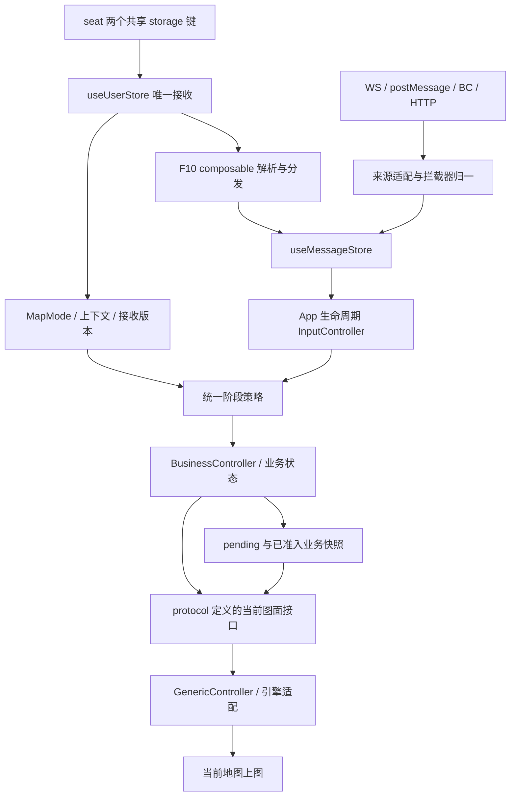

# Control 走线迁移清单与替换方案

## 1. 文档信息与核验结论

- 日期：2026-10-15；核验版本：`319fa44564f72d7a0284829a71e4a2cf27039505`。
- 范围：F1～F14、`src/Control/` 全部 18 个文件，以及相关 store、拦截器、组件、应用装配。
- 当前阶段：**P0 方案核验；本轮仅修改文档，未实施代码迁移。**
- 契约依据：`docs/source/07-协议事件清单.md`、`docs/source/协议层DTO Schema.tsd`、`docs/source/08-业务状态机定义.md`。
- 配套：[整体核验报告](Control走线迁移方案核验报告.md)，包含问题证据、整改映射和当前验证结果。

**结论：原方案不能直接作为“迁移达标、编码无副作用”的证明。** 本版已统一阶段谓词、应用与地图生命周期、异步失效、恢复数据和实施顺序。可据此拆分实施批次；只有对应实现、自动化回归、人工调试均通过，才能判定该批迁移完成。F12 协议及其现有缺陷仍冻结，整体迁移验收与 Control 清理条件尚未满足。

本文的“目标”“需新增”“迁移后”均为设计要求，不表示当前代码已具备该能力。后续实施必须按 §8、§12 回填证据，不能将设计修订状态写成代码通过状态。

## 2. 行为基准、现状与边界

### 2.1 旧中枢与装配基准分开认定

**旧业务中枢为 `src/store/useMessageStore916.ts`。** 它的归一链、事件索引快照、准入门控及 handler 是迁移对照基准；不得因新中枢已存在就判为废案。

`src/store/useMessageStore.ts` 为目标消息中枢，已有注册式拦截器、多结果分发与 BroadcastChannel 接入，但尚未完整覆盖 916 行为。

| 对照项 | 当前事实 | 迁移要求 |
|---|---|---|
| 旧业务链 | 916 归一 → 阶段门控 → 业务订阅 → `mapMessageHandlers` → pending/定位 store → 组件上图 | 用固定输入和副作用记录建立对照，不以“文件无人装配”代替功能分析 |
| 旧装配 | `initMessage916.ts` 保存旧订阅组合；`Control/initMessage.ts` 含 V2 CONNECT、单入口 URL、连接 key 等较新实现 | 两者分别取证；不能把 916 装配整体称为当前 V2 可用配置 |
| 当前应用入口 | `App.vue` 装配 `register/initMessage.ts`，未装配旧 Control 入口 | 业务基准与当前默认启动链路不是同一概念 |
| storage 启动 | `initUserStore` 已有实现，但默认源码启动路径没有调用点 | 补 bootstrap；不能据静态分析断言所有宿主场景“永远无法连接” |
| 控制器生命周期 | `map.vue` 就绪后注册 InputController，卸载即销毁；`dispatchMap.vue` 另建来电控制器 | 不能直接删除 dispatchMap 订阅或复用绑定旧地图的实例 |
| 定位归一 | `transforms/incidentLocation.ts` 为空；已有定位/GPS/应答归一也存在包装与匹配差异 | 补齐全部输入形态，不只是补两个 transform |
| 持久化 | 新中枢 `lastBySystem` 按系统保存；旧中枢还保存事件键索引 | 恢复不能继续把系统索引当事件索引使用 |
| 当前旧入口 | HEAD 和工作区中的 `Control/initMessage.ts` 均为 234 行旧装配，仍调用 `setIngressGate` | 旧文档“工作区改成 68 行门控、未提交”的表述已过期；68 行为 `messageStageGate.ts` |
| 目录命名 | `Control` 与 `controller` 语义重叠，且业务归属混杂 | 这是命名与职责问题；二者并非仅大小写不同，不存在所称文件系统同名冲突 |

### 2.2 保持与允许变化

**保持：**既有事件键、WGS84 经纬度顺序、点位归并、槽位缺省/显式清空差异、版本仲裁、真实来电结束保留粗定位、当前已禁用的图层/路径分支、F12 V1.0 线协议。

**本次需求明确的变化：**共享状态及 mock storage 接收统一进 `useUserStore`；阶段统一读取原始 `MapMode`；F10 多字段独立分发并内聚旧入口判断；业务职责移出 Control；F12 仅迁 composables 并隔离通用收发工具。

**需在各批实现中验证的缺陷修正：**跨页丢消息、异步旧响应回写、重复执行保留字段、WS 会话清理串扰、错误匹配/快照恢复。必须留下前后差异用例，不能笼统宣称“所有行为零变化”。

### 2.3 范围外

不重写通用图形引擎；不改 `plugins/mapPlugins` 独立库链路及三维 modelAssess；不顺带启用已注释的主管/支撑辖区面、支撑队站路线等功能；不升级或修订尚未出文档的 GIS 选点 BroadcastChannel 协议。

## 3. 全部功能迁移清单

| 编号 | 功能及旧职责 | 当前缺口/消费方 | 目标落点 | 完成判据 |
|---|---|---|---|---|
| F1 | 画像地址、坐标、主管队站槽位更新；缓存与切警情清理 | 916 + `incidentLocationMessage` + handlers；定位 store、dispatchMap 多个 watcher | interceptor + protocol DTO + 定位 store + `IncidentLocationController` + 引擎适配 | 增量/全量语义、版本、点位归并、队站/周边资源/路线均对齐 |
| F2 | 警情 CREATED → 缓存画像 → 调派切页 | 新链下游缺完整 handler | `AlarmController` 写 pending；pageCondition 编排导航 | 去重、先缓存再切页、无坐标时补源不丢 |
| F3 | 来电应答状态 → 请求页条件 | 新链缺旧 handler 行为 | `CallController` 产出页面意图；pageCondition 执行 | answered/newState/ended 组合与旧基准一致 |
| F4 | 来电粗定位圈、点位与文本 | /map 与 /dispatch1 分别注册/建控制器，存在切换空窗 | App 级接收与缓存；当前地图适配绘制 | 任一时刻只有一个活跃图面消费；跨页可重建，无重复飞行 |
| F5 | `ALARM_PROFILE_SYNC` 兼容画像入口 | 有控制器消费，缺明确的现行生产者 | 保留协议与消费兼容；核对上游实际输入 | 兼容回放通过；不擅自发新消息或删除键，不与 F13 混淆 |
| F6 | GPS 批量归一、车点刷新与首次视图定位 | 生产者为 `{datas}`，DTO 为 `{incidentId,layerId}`；DispatchT1 自订阅真渲染 | protocol 批量 DTO + `TrackingController` + 通用运动/图形能力 | 车点、车型/编号、坐标、时间、首次缩放行为对齐；无 OL 进入业务层 |
| F7 | 地址机器人 GIS 搜索/候选/清理 | 新链已有基础接线，旧链有特殊地址机器人入口 | 复用 dispatcher + `AddressRobotController` | WS/转发来源均保持；无事件时不随意清空面板 |
| F8 | 六类消息阶段准入与 500ms 稳定窗口 | 新链未接入；原方案谓词与旧基准冲突 | IO 层唯一 `messageStagePolicy` | §10.3 真值表、逐条延迟队列与退出取消通过 |
| F9 | phase、REQUEST/DISPATCH 条件、刷新路由守卫 | App 仍用旧 pageCondition；router 直读共享键 | `register/pageCondition.ts` + store 快照 | 同一页面意图只导航一次；普通导航不覆盖 flood |
| F10 | 模拟来电增删、模拟调派、特灾进入/退出、灾害点、车辆模拟 | 旧入口 storage 分流；桥与组件共同实现 | `composables/useMockCallLocationBridge.ts` + 统一接收执行器 | 一次解析、字段级幂等、就绪后执行、异步依赖和退出撤销通过 |
| F11 | 地图屏 relay：画像、POSITION_SYNC、地址机器人、hello/bye | 新入口未装配 `mapRelayReader` | `composables/useMapRelayReader.ts` + 共用归一器 | 保持通道/事件/周期；全量标记与跨来源版本仲裁不丢 |
| F12 | GIS 二次定位 BC 会话、选点与 ACK | 新业务，必须保留；当前 ACK/取消/重试有既有缺陷 | `composables/useGisPointSelection.ts` + `useBroadcastChannelBridge.ts` | 本批仅等价迁位；协议冻结及可靠性缺陷见 §11.3，不能标完整验收通过 |
| F13 | 按 incidentId HTTP 拉取画像全量快照 | 启动首次拉取被 lastId 判断跳过；在途 A 可覆盖 B | `composables/useIncidentLocationProfileSync.ts` + service + 标准消息入口 | 首次拉取、A→B 竞争、旧版本与失效请求均受控 |
| F14 | 共享状态、凭证、租户、追踪头、阶段等待工具 | 工具被 service/router/组件/控制器引用 | store 保存事实；protocol 定类型；utils 纯转换；等待逻辑用 store | 两个 seat 共享键无业务裸读/裸监听；请求头语义不变 |

F1 同时覆盖此前未走控制器的点位、主管图标、周边资源范围圈、队站过滤、路径与聚焦显示。F6 覆盖 DispatchT1 内车点消费。F12 的冻结例外必须登记，不能据此宣称“全项目所有显示已经控制器化”。

## 4. 目标分层与完整消息流

### 4.1 接收、状态与绘制

已是内部标准事件的 F10/F12 不再伪装成外部业务帧重复解析；均经消息中枢发布订阅路径进入接收端。HTTP/relay/本地点位确认也不能直接调用 handler 或绕过准入策略。对外发送继续使用 `controller/publish` 门面；F12 原始 PICK 消息通过其冻结的专用通道，见 §11.3。

### 4.2 采用的生命周期方案

选定“**App 级接收与业务状态 + 地图级渲染绑定**”。不采用仅在 /map 安装接收者，也不采用长期保存已销毁 OL Map 的控制器单例。

| 生命周期 | 所有者 | 职责与释放 |
|---|---|---|
| App | `mountApp` → 消息 runtime | 唯一 storage 接收、InputController 业务订阅、门控、页面意图、F10/F11/F13 装配；卸载全部 dispose |
| 消息会话 | `register/initMessage` 的 sessionDispose | 唯一 WS 连接；登出/换用户/换席释放旧连接及其待交付数据；不关闭 App 级桥 |
| 地图 | /map、/dispatch、/dispatch1 容器 | 创建自身 GenericController/引擎资源，向 runtime attach；卸载 detach 并销毁引擎资源 |
| 选点 | F12 既有会话 | 保持现有 V1.0 行为，迁位时不能改成另一套会话模型 |

新增 `controller/core/io/BusinessMessageRuntime.ts` 管理接收生命周期及当前图面绑定。`InputController` 的业务订阅只注册一次；`initSubscriptions` 必须幂等。通用 `map.base.*` 指令仅交给当前已就绪图面，不能无限缓存、跨图重放。

`BusinessController` 通过 protocol 中的 `BusinessMapPort` / 通用 DTO 接口访问当前图面；runtime 在 attach 时绑定具体 GenericController 和必要的引擎适配。接口不暴露 OL/Three 类型。业务控制器不持有旧地图；无图面时先完成状态接收，绘制从已准入状态重建。

实施时必须同步完成控制器构造参数、聚合属性、导出与释放，而非仅新增一个未实例化的 `IncidentLocationController` 文件。新建 port 应覆盖本批使用的既有能力，不重写全部图形 API。

### 4.3 跨页与就绪语义

1. 定位、立案画像等可恢复状态，先通过准入校验写入对应 store，再产生页面意图；地图未就绪时不能丢弃。
2. attach 返回/提交地图 generation；状态以稳定业务 key upsert，不因地图重建重复发 HTTP、飞行或模拟命令。新 Map 实例需要重建要素，“跨页绝不重绘”不是有效标准。
3. F10 瞬时指令仅暂存本运行期间已接收且未完成的任务；绑定 session/context/generation，地图就绪后执行一次，不通过重新读取整个 storage blob 补偿。
4. detach 先停止本图面任务、解除订阅/交互/动画，再销毁地图。A 地图的晚响应不得写入 B 地图。
5. 保留当前 `dispatchMap` 真正离开调派页时清空定位运行态和 slot 缓存的业务语义，由唯一业务出口执行。不能把“持久接收”理解成所有状态永久保留；同页渲染器重建则按有效上下文重建。
6. 进入 /dispatch1 前已有的新 pending 不能被旧 /map 的 detach 清掉。F10 flood 退出先撤销 pending 与旧任务，再允许普通页面意图恢复。

**删除组件订阅的前置条件：**本页 attach、状态重建、就绪等待和 detach 均已有测试证明；同批停掉旧渲染 owner。禁止“新控制器 + 旧组件兜底”同时绘制同一业务。

### 4.4 分层职责与副作用唯一归属

| 层 | 负责 | 不承担 |
|---|---|---|
| interceptor | 解包、路由识别、形状/字段清洗、归一 | Router、MapMode 判断、绘图、HTTP |
| useMessageStore | 通道绑定、信封、发布订阅、通用记录与索引 | 业务阶段、警情切换和地图对象 |
| IO/runtime | 唯一业务订阅、调用统一策略、图面绑定、任务生命周期 | 在每个 callback 重写阶段判断 |
| business | 数据归并后的业务决定、组装通用图形 DTO、页面意图 | `import 'ol/...'`、Three、直接调用 router |
| store | 原始共享事实、pending、画像槽位、版本及可恢复状态 | 裸监听分散到各业务、持有引擎资源 |
| register/pageCondition | 启停装配、路由守卫与页面意图落地 | mock 字段分支、画像解析 |
| 引擎适配/组件 | 实际图层、交互、图面就绪、展示 | 自订阅业务并再次归一、另起一份业务缓存 |

`vehicleManager.ts` 当前直接依赖 OL；不可仅让 TrackingController 调用它就宣布分层合规。渲染部分迁入地图适配，共用运动/图形能力留在 generic；业务选择和 DTO 装配归 TrackingController。`IncidentStationQuery` / `IncidentNearbyResourceQuery` 的 OL 距离等依赖需复用公共工具或隔离到引擎适配，跨层仅传 protocol 数据，不能把 OL geometry 搬进 business。

## 5. 文件落点与处置闭环

### 5.1 Control 的 18 个现存文件

以下“退出旧路径”均仅在 P3 执行。P1/P2 保留旧实现及其依赖闭包。

| 旧文件 | 目标职责/落点 | 旧路径处置条件 |
|---|---|---|
| `initMessage.ts` | 连接配置迁 register；mock 判断迁 F10；其他入口按各功能归位 | 装配行为验证后，随旧入口整体停用 |
| `initMessage916.ts` | 保留旧装配对照 | P2 通过且确认清理后，与 916 闭包同批退出 |
| `mapMessageHandlers.ts` | F1/F2/F3/F4/F5 拆至业务控制器与页面意图 | 916 仍依赖时不可注释/删除 |
| `messageStageGate.ts` | `controller/core/io/messageStagePolicy.ts` | 策略回放对齐后退出旧装配 |
| `positionMessage.ts` | 定位归一迁 interceptor；订阅构造迁消息装配工具 | 保留 916 归一依赖到 P3 |
| `carLocationMessage.ts` | DTO 迁 protocol；归一迁 interceptor | 全部类型引用迁完，并与 916 同批清理 |
| `alarmCallMessage.ts` | DTO 迁 protocol；应答归一迁 interceptor | 同上 |
| `alarmMessage.ts` | 状态 DTO/归一、画像转换分别归 protocol/interceptor/business；URL/会话构造归装配工具 | 所有职责都有承接点后退出 |
| `incidentLocationMessage.ts` | DTO→protocol；解析→interceptor；slot 缓存→定位 store | 不能先删 916 的归一/缓存依赖 |
| `incidentLocationProfileSync.ts` | `composables/useIncidentLocationProfileSync.ts`；请求/转换放 service | 补源并发与全量语义通过后退出 |
| `mapRelayReader.ts` | `composables/useMapRelayReader.ts`；复用归一与 BC 工具 | hello/bye、事件种类、快照仲裁通过后退出 |
| `mockCallLocationBridge.ts` | `composables/useMockCallLocationBridge.ts`；跨模块 DTO 进 protocol | pending 消费方、类型、装配均改完后保留对照到 P3 |
| `gisPointChannel.ts` | `composables/useGisPointSelection.ts` + 通用 BC bridge | 新业务保留；冻结项未闭环不能借迁位删除 |
| `seatSharedState.ts` | 状态接收→useUserStore；类型→protocol；纯会话/头部转换→utils | service/router/组件/控制器引用全核对 |
| `pageCondition.ts` | `register/pageCondition.ts` | App 改装配；页面条件自有键仍保留 |
| `dispatchVehicleAdapter.ts` | `service/methods/dispatchVehicleAdapter.ts` | HTTP 适配契约对齐；自身类型问题在该批处理 |
| `Swiper.ts` | `baseComponent/OpenlayersMap/SwipeControl.ts` | 保持 ol 控件行为，改 swipeControl 消费 |
| `Swiper.css` | 随控件迁同目录 | 更新 CSS import 后保留对照 |

`src/composables/Swiper/` 另有同名实现，内容并非完全相同。迁移前比较选项、事件、渲染及 CSS，只保留经消费方确认的一个实现；不得直接当成相同文件覆盖，也不顺带改动未用副本。

### 5.2 目录外的新增/修改

| 层 | 涉及文件 | 修改内容 |
|---|---|---|
| bootstrap/register | `lib/index.ts`、`App.vue`、`register/initMessage.ts`、`register/pageCondition.ts` | storage 提前初始化、runtime 单次装配、清理分域、路由编排 |
| interceptor | `unwrap.ts`、`matcher.ts`、`install.ts`、各 transforms/dispatchers | 兼容包装、排他匹配、916 顺序、画像归一、席位更新、最终 T1 兜底 |
| store | `useUserStore.ts`、`useMessageStore.ts`、`useIncidentLocationStore.ts`、pending stores | 快照版本、已准入状态、事件索引、画像缓存、生命周期清理 |
| IO/business/protocol | `InputController.ts`、新 runtime/policy、`business/index.ts`、Alarm/Call/Tracking/IncidentLocationController、protocol | 新构造/聚合、唯一接收、DTO、port、异步代次 |
| 引擎/组件 | `map.vue`、`dispatchMap.vue`、`DispatchT1.vue/.ts`、`specialMapMock.ts`、车辆/资源适配 | attach/detach、移除重复 owner、异步失效；F12 消费仅兼容迁位 |
| 通用类型/常量 | `types/message.ts`、`const.message.type.ts` | 类型化来源/全量元数据、LOCAL_STORAGE、必要的通用快照能力 |
| 契约与测试 | `docs/source/**`、`tests/unit|components|e2e/**` | 同步真实变更、批次验收证据 |

`useMessageStore916.ts` 及其依赖完整保留为旧链对照。`store/interceptor-integration.ts`、`store/messageInterceptors.ts` 的未引用双实现可登记待清理，不能与 916 混为废案。

## 6. 归一、消息契约与恢复语义

### 6.1 916 兼容顺序与输入覆盖

| 顺序 | 归一项 | 必须覆盖 |
|---|---|---|
| 1 | 地址机器人特判 | 现有 `notifyType=addressbot` / `AddressLocationUpdated`；relay 对应来源 |
| 2 | 定位 | seat/{seatKey}、POSITION_SYNC、位置网载荷、无 topics 合法业务体、包装/列表、多条点位 |
| 3 | GPS | topics/notify 形态、裸 `{datas}`、包装层、非法项过滤与帧内去重 |
| 4 | 来电应答 | 原始及嵌套 customContent、eventId 等 metadata |
| 5 | 警情状态 | CREATED/其他状态、深层包装与 metadata |
| 6 | 画像地址 | slots 与 slotChanges、画像/警情标识、相关槽位过滤 |
| 7 | T1 fallback | 仅此前未产出时，按旧 `payload.eventType ?? payload.eventKey` 归一 |

保留旧 normalizer 支持的 `request/data/body/message/payload/userMsgBodyList` 包装，继承外层路由与 metadata。先核对公共 `unwrap`，不足再补输入适配；不要在每个 controller 复制 JSON 解包。

专属拦截器使用明确且不相同的优先级，命中即 stop；SEAT 的多结果扇出在其内部完成后停止外层重复匹配。**priority 不能修复错误匹配：**有显式 topic/notify/eventName 时，其他事件不能仅凭 `customContent.data` 存在就命中；缺路由信息时才允许事件专属形状兜底。

T1 不注册成可能与专属结果一起执行的 `stop:false` 普通拦截器；放在中枢现有“归一无结果”兜底分支。继续保留新链多结果、BC 能力，归一后的信封只分发一次。`buildPositionSubscription` 当前已是 seat/{seatKey}，不再将其描述为另一条独立 POSITION 订阅。

### 6.2 DTO、来源与版本

| 项 | 设计约束 | 实施同步 |
|---|---|---|
| 地址 DTO | `AddressUpdatedData` 迁 protocol，保留现有标识、version、address/longitude/latitude/primaryStationId、slots 的缺省与 null 语义 | 事件清单、DTO schema、所有 type import |
| GPS DTO | `TrackingVehicleGpsUpdateData` 使用实际 `{datas: CarLocationPoint[]}`，保留原点位字段；layerId 由渲染适配决定 | 生产者、控制器、DispatchT1 同批更新 |
| mock DTO | 调派车辆、灾害点、模拟命令及来源元数据类型进 protocol | 组件不反向 import composable 的内部类型 |
| storage 来源 | 当前常量没有 localStorage，需新增 `MESSAGE_CHANNEL.LOCAL_STORAGE` | 常量、类型、事件文档、消息协议速查 |
| HTTP 来源 | 保持内部消息通道与来源概念分离，新增明确 `meta.source='http-profile'`；不称其为实际 WS 接收 | 类型化 metadata 与内部接收接口 |
| 全量/增量 | 明确 `snapshotKind: 'full'|'delta'`；HTTP/relay 全量为 full，WS 槽位增量为 delta | 不再依赖 `id.startsWith('profile-sync-')`；metadata 不能在 ingest 重建信封时丢失 |
| 会话/上下文 | metadata/任务记录带 sessionEpoch、contextKey、接收序号 | 失效后不更新版本、水位、缓存或图层 |

所有跨层新增接口使用 protocol interface/明确 DTO；不通过 `any` 或双重断言掩盖不匹配。F12 外部 PICK 字段、通道、版本不随本节修改。

### 6.3 三种数据不能混同

1. `inbox/lastBySystem`：消息基础设施记录，含尚未通过业务门控的数据，只用于诊断/通用索引。
2. `lastByEventKey` 或等价明确 API：补齐通用事件索引与清除能力，不再混用系统键；历史持久化不能直接视为本次会话有效数据。
3. **已准入业务快照**：由唯一接收者在门控及上下文校验通过后写入 pending/定位 store，带会话、上下文和消费状态；这是图面恢复的依据。

门控移到订阅后，拒绝的原始消息可能已在 inbox 中，不能从它自动恢复上图。F5 刷新时先依据当前共享快照验证业务恢复数据，再 attach 图面；onDuty/登出时清理对应业务恢复数据。兼容旧 sessionStorage 数据须有显式适配与失效规则，不能假设新字段已存在。

## 7. 分批实施顺序与启用顺序

### 7.1 开发顺序：先准备，再集中启用

| 批次 | 内容 | 切换前必须具备的证据 |
|---|---|---|
| M0 | 固定 HEAD/类型基线/输入样本、旧副作用记录、A/B 隔离环境 | 916 及依赖可回放；禁止同时装配两个同 ID store |
| M1 | protocol/metadata/GPS 契约、store 快照/revision、会话与头部纯转换 | DTO 一致；缺省/null/auth/phase 真值表通过 |
| M2 | 输入适配、严格 matcher、五段归一及地址机器人/T1 顺序、席位动态规则 | 与 916 帧回放对齐，无重复归一与错路由 |
| M3 | App runtime、Input 唯一订阅、集中门控、已准入恢复数据、地图 port | 地图未就绪与切换测试通过；策略只安装一份 |
| M4 | F1/F2/F3/F4/F5/F6/F7 业务与当前地图渲染；F9 页面意图 | 分批停止旧 owner；构造、聚合、清理完整 |
| M5 | F10 composable；F11 relay；F13 HTTP 补源 | 多字段幂等、异步顺序、跨页 pending、旧响应失效通过 |
| M6 | F14、HTTP 适配、Swipe 控件归位；F12 仅等价迁位方案 | 所有旧依赖有目标；F12 冻结/缺陷状态明确登记 |
| M7 | bootstrap 接线与通道集中启用；V2 URL/CONNECT/订阅回执 | M1～M6 所属启用功能全部就绪；WS/宿主通道开关与生命周期回归 |
| M8 | P2 新旧隔离 A/B 与 §12.6 人工调试 | 全部记录回填；未通过项保留旧实现，不清理 |

M1 可先开发 `initUserStore` 初始化能力，但在 M7 前不能将带已知下游缺口的接收链整体激活。**“先修初始化”是依赖关系，不是让真实 WS 在归一/接收者尚未完成时先上线。**

### 7.2 运行时启动顺序

`mountApp` 中按以下顺序装配，App 不再二次创建同一消息 runtime：

1. 创建应用与 Pinia；安装 Pinia。
2. 同步启动 `initUserStore`，读取共享键及 mock 原始值。
3. 创建 App runtime、门控、业务订阅及页面意图缓存。
4. 安装 Router；首次守卫读取 store。路由未就绪时暂存意图，ready 后交给唯一 pageCondition 协调器。
5. 创建 F10/F11/F13 等生产端、应用通道及会话 watch；此时已有接收者。启动恢复先写业务状态，不依赖子组件订阅。
6. 挂载图面，attach 就绪适配，重建有效状态并消费运行期 pending。
7. App unmount 统一逆序 dispose；bootstrap 中途失败也释放已创建资源。

### 7.3 WS 会话装配约束

- 复用 `useWebSocket` 现有 V2 connectAuth、connected、subscribed 处理；以 `Control/initMessage.ts` 的 V2 部分为参考，不照搬当前 register 的身份 URL 拼接。
- 单入口 URL、CONNECT 首帧、鉴权成功后订阅及回执均需验证；不能把 TCP/WS open 等同于鉴权与业务订阅成功。
- connectionKey 至少包括 userId/sessionId/seatKey。换用户、会话或席位先释放唯一旧连接、清旧队列和匹配状态，再以新席位快照装配。
- Token 刷新不无故重建相同 key 的连接；自动重连的 CONNECT 从 store 读取最新 token/tenant，订阅恢复使用该连接所属的席位快照。
- 线上订阅来源包括用户地图收件箱、有效 seat/{seatKey}、GPS、画像及 F2/F3 所需状态来源。当前旧入口 F2/F3 显式订阅有注释；必须核实是否由用户收件箱转送，不能仅宣称“五类已订阅”。缺少来源即不通过该功能验收，不擅自新增后端 topic。
- 不发送 `SEAT` 函数对象；席位变更同时更新本地 matcher 与实际订阅，未绑定席位不发 seat 订阅。
- sessionDispose 只持有一个当前 WS 释放函数；App 通道、F10/F11/F12、store watch 不混入会话清理数组。

## 8. 验证方法与证据要求

### 8.1 自动化回归

| 测试组 | 必测情形 | 证明对象 |
|---|---|---|
| 输入归一 | 包装列表、无 topics、显式 ALARM_CALL 同含 incidentId、地址机器人、GPS、slots、T1 | 无漏帧/误匹配/双分发，data 与 metadata 对齐 |
| 阶段策略 | §10.3 全真值表、500ms 前后、共享状态再次接收、同 updatedAt、A→B→A、dispose | 保留逐条队列；不变成只留最后一条的防抖 |
| runtime/地图 | 事件先于挂载、/map↔/dispatch1、同页重建、detach 后旧异步完成 | 不断链、不操作旧 Map、不重复副作用 |
| 画像状态 | full/delta、显式清空、仅主管变化、版本回退、HTTP A→B、WS/HTTP 竞争 | 不串警情、不回滚、不双查询，不提前 clearAll |
| F10 | 启动恢复、多字段、仅命令变化保留灾害点、未就绪、退出/卸载 | 无重放、无重复清场、render 完成后才 simulate |
| 会话/通道 | 无会话启动、WS 关闭、登出再登录、换席、重连、两次 mount/unmount | App 通道不误销毁；旧连接和 timer 无泄漏 |
| F12 冻结回放 | 对象/字符串输入、token、ACK、延迟取消、创建/发送异常、首包丢失 | 记录既有差异；失败用例不能标通过，见 §11.3 |

测试应接真实适配边界，通过输入与输出断言行为，不能仅检查方法名、mock 调用顺序或复制实现。复用现有 Vitest/组件/Playwright 体系；本轮不新增测试代码。

### 8.2 A/B 隔离

916 与新 store 的 Pinia ID 都为 `messageStore`。**禁止在同一个 Pinia 中直接导入两者切换比较。** 采用独立应用/Pinia 与隔离存储命名空间，或刷新后只装配其中一种；拦截器注册表、会话快照、计时器同样隔离。

相同固定输入比较：归一事件/载荷/meta、准入结果与交付时间、状态变化、HTTP 次数、路由意图、图形指令、清理结果。任何时刻只有一侧操作真实地图和 Router，另一侧只记录输出。旧链外部传输配置无法直接运行时，可回放其业务归一与 handler；不能伪造“旧链完整在线对照通过”。

### 8.3 门禁与本轮实测

后续每批代码变更前后执行严格类型基线比较：PowerShell 中设置 `LINT_BASELINE_STRICT=1` 后运行 `pnpm lint:baseline`。判据为**没有新增诊断身份**，不是总错误数下降。默认脚本仅提示，退出码 0 本身不证明无新增；还要确认检查器实际运行成功。

代码迁移各批须有相关 Vitest 用例，接线变化执行 E2E；收口执行 `pnpm build` 和 `pnpm build:lib` 两种构建。构建可能刷新自动生成文件，不得手改它们。项目文档变更检查 `pnpm harness:check` 与 `git diff --check`。

本轮仅对现有代码做只读检查，结果：
- 严格类型基线：**191 / 191，无新增**。
- 既有 matcher、unwrap、mapStartup、publish：**4 个文件、28 个用例通过**。
- 以上不是新迁移链路的验证；本轮未执行端到端人工联调、两种构建或 F12 协议可靠性确认。

## 9. 风险、行为差异与回滚

| 风险/差异 | 处理与回退 |
|---|---|
| 原门控表误放行 | 固定 §10.3 真值表，与 916 回放；不能通过改 MapMode 为 dispatch 修补 |
| 归一顺序/包装差异 | 显式路由排他 + 输入适配；任何漏帧/误帧阻止启用 |
| App/会话/map 清理混用 | 三域清理；按域 generation 失效，不让登出永久移除宿主通道 |
| F1 渲染 owner 交叠 | 按点位→资源/队站→路径分批；每批只切一个 owner，不能双跑兜底 |
| 请求跨警情/旧图回写 | 在清理和任何 await 后检查 session/context/request/map generation；失败不动新上下文 |
| HTTP/relay 全量被当增量 | 明确 snapshotKind；通过校验后再 replace，禁止靠 id 前缀猜 |
| mock 保留字段重复清场 | 字段级消费状态，不能只按整个 raw 或根 updatedAt 去重 |
| 历史代码已禁用的功能被顺带恢复 | 维持主管/支撑辖区面、支撑路线等当前关闭状态；另案决定启用 |
| F12 冻结与已知缺陷 | 独立列示，不能以“未改线协议”推导重试可靠；不据此清理旧实现 |
| 回滚触发 | 新增类型错误、错路由、跨警情、重复绘制、晚响应回写任一出现，停止该批入口、取消任务并恢复该批旧 owner |
| 回滚恢复方式 | 刷新后以旧装配/独立 Pinia 恢复；清除该批新状态再回放基线快照，不在运行中混用两种同 ID store |

本次明确修正的设计偏差包括：多字段 F10 独立分发、实际来源标记、生命周期补偿、全量语义显式化与旧响应失效。除这些有对应回归的项目外不扩张业务规则。任何新增线上语义必须先回写本表及契约，不能靠人工调试“顺便决定”。

## 10. useUserStore、MapMode 与集中门控

### 10.1 唯一接收与状态发布

`initUserStore` 统一监听既有五键及新增 `seat-shared-state-mock`；返回幂等 dispose，由 mountApp 持有。各业务不得再直接监听或读取这两个 seat 共享键，纯工具接收 store 快照参数进行转换。

| store 字段 | 语义 |
|---|---|
| `MapMode` | **保持 `store.MapMode = shared?.phase ?? 'onDuty'`；原始 phase，不写投影阶段** |
| `rawState` | 本次共享快照；v、updatedAt、auth、user、seat、currentAlarm、mode 等有类型定义 |
| `currentAlarm` | 与 rawState 的字段语义一致；保留缺省、null、有效对象差别，不能统一 `?? null` |
| `mode` | 特灾模式事实，不混进 MapMode |
| `sharedStateRevision` | 本实例每次接收共享键/clear 递增；不依赖上游 updatedAt 唯一 |
| `seatSharedStateMockRaw` / `mockRevision` | mock 原始字符串/接收版本；store 不解析模拟业务字段 |
| `sessionEpoch` | 用户/会话/席位及登出边界失效标识，用于取消旧任务 |

同一次接收中集中更新所有字段，事实齐备后递增提交 revision；消费方观察 revision 再读取 MapMode/上下文，避免多个独立 watcher 看到半更新状态。门控的接收时间更新使用同步提交观察，快速 A→B→A 不被批处理吞掉。阶段决策仍统一读 MapMode，revision 仅表示“收到了一次完整输入”。

MapPhase 类型补 `dispatchTrack`，唯一定义置于 protocol 共享状态接口；未知/非法原始 phase 不自行投影成 dispatch，准入按无效上下文处理。MapMode 默认 onDuty 不表示共享状态合法或已登录。

### 10.2 统一上下文合法性

与旧 `parseSharedMapStage` 对齐：
- v 必须为 1，updatedAt 必须是有限数；损坏 JSON/不符合版本的快照为无效上下文。
- `auth === null` 表示登出；auth 缺省、非对象或数组为无效上下文。
- 有效 auth 对象前提下，保留原始 phase；`inquiry + currentAlarm === null` 是未立案问询。
- 调派上下文唯一定义：**合法快照且原始 phase 为 inquiry，currentAlarm 是对象且 incidentId 为非空字符串**。
- inquiry 的 currentAlarm 缺省或对象内 incidentId 空缺，不等同于 null 问询。
- literal `phase='dispatch'` 虽出现在类型中，旧解析并未放行；本次不自动扩展其业务含义。

helper 放在 `messageStagePolicy` 的纯策略部分，接收 protocol 快照，不读 storage、不依赖 Router。门控与路由复用同一上下文解释；store 不保存派生的 dispatch 阶段。

### 10.3 唯一阶段真值表

以下六类事件先要求 §10.2 合法且未登出，再按谓词放行；其余上下文拒绝：

| 事件 | 唯一允许条件 |
|---|---|
| `MAP_LOCATE_CALL` | `MapMode === 'popup'` |
| `ALARM_CALL_ANSWER_STATUS_CHANGED` | `MapMode === 'inquiry' && currentAlarm === null` |
| `ALARM_INCIDENT_STATE_CHANGED` | 调派上下文（inquiry + 有效 incidentId） |
| `ALARM_PROFILE_SYNC` | 调派上下文 |
| `DISASTER_PROFILE_ADDRESS_UPDATED` | 调派上下文 |
| `TRACKING_VEHICLE_GPS_UPDATE` | `MapMode === 'dispatchTrack'` |

无规则事件保持旧链立即交付行为；mock 特灾指令另受 mode/任务上下文约束，不能把所有 MOCK_* 机械套 popup 门控。MAP_LOCATE_CALL_REMOVE 的真实/模拟清理差异见 §11.1。

六类消息每条保留接收时刻，最早交付时间为 `max(receivedAt, lastSharedReceiveAt) + 500ms`；共享状态每次接收都重算稳定窗口。到期读取当前完整上下文；不匹配则丢弃并记录原因。保留消息相对次序和逐条队列，不改成 debounce 只保留最后一条。

登出/换会话/销毁取消队列与 timer，失效闭包不能重新交付。业务 subscribe 统一经过 `subscribeBusiness` 包装器，不恢复业务化的全局 `setIngressGate` 到消息基础设施。

### 10.4 旧 storage 消费逐项替换

| 消费点 | 新来源及动作 |
|---|---|
| Control 两个 init 的会话监听 | register 观察已提交会话/席位快照，§7.3 处理 |
| `messageStageGate` | sharedStateRevision + MapMode/上下文，§10.3 处理 |
| `whenDispatchTrack` | 基于 store 的一次性订阅，当前已满足则立即执行；调用方保存 stop |
| `pageCondition` / router | 读 store 与统一 helper；保留 `ids-gis:page-condition` 自有键监听 |
| `incidentLocationProfileSync` | 初值及 incidentId/sessionEpoch 变化，§11.2 处理 |
| 地址 slot 缓存 | 读集中上下文；onDuty/登出/离开调派业务出口清理 |
| InputController 回值守 | 合法初值 onDuty 时清 pending；每次共享提交有效 onDuty 时清 pending/粗定位，保持旧语义 |
| service、HTTP 头、演示页凭证 | 使用 store 共享事实传入纯工具；不在每个请求前重新 parse storage |
| `utils/storage` 通用监听 | 与本议题正交，保留 |

**不采用原方案“仅从非 onDuty 过渡才清”的隐含变更。** 初始清理与每次有效 onDuty 提交的清理保留；持久化快照是否清除，按对应旧调用点是否实际启用逐项回放，不能把原来注释的 clearLastByEventKey 顺带启用。

页面意图只能由 register/pageCondition 执行 Router 调用。F2 先 queue 再请求 DISPATCH；F3 与 F4 保留旧 REQUEST/清条件顺序。普通 phase 意图按接收序号合并到最新有效目标，防并发 replace 取消；业务数据不得因导航合并丢失。flood 期间普通意图不执行，特灾进入/退出判断仅归 F10。

### 10.5 storage 事件与凭证约束

storage 只通知其他标签页，集中到 store 不改变这一语义。同页写入若需响应，必须经显式 store action 同步提交，不能重新增设裸监听。

`key === null` 时统一清理已监听键；无初始 mock 与运行期 mock 删除要区分。损坏共享输入不能因 MapMode 默认 onDuty 就被当成合法业务阶段。

`seat-auth-session` 的 token 兜底不得在主共享状态明确 `auth=null` 后“复活”会话；也不能 spread 一个 null session 构造缺 userId/sessionId 的有效连接。凭证/tenant/trace 的缺省、空值和头部保留语义按旧工具回归，不打印凭证。

现有自定义 handlers 会覆盖默认同名处理，本次 F10 纳入默认 handler，不使用覆盖入口接业务。若扩展 API，默认状态更新先完成，附加观察者后执行且异常隔离，不能让扩展回调阻止核心同步。

## 11. 三条旁支与特殊业务

### 11.1 F10 模拟流程桥

**目标文件：`src/composables/useMockCallLocationBridge.ts`，保留 `createMockCallLocationBridge` 兼容工厂名。** 所有模拟接收从 useUserStore 获取；旧 `Control/initMessage.ts` 的 wasFlood/isFlood、分支判断、初始化恢复、导航意图、pending 管理全部迁入桥，register 只装配/dispose。

| 输入/判断 | 目标行为 |
|---|---|
| 启动已有 callLocation | 按现行坐标/固定 mock callId 归一并投 MAP_LOCATE_CALL，经准入后保存；无 key 不误投 remove |
| 启动已有 mode=flood | 生成特灾进入意图，pending 等待当前调派地图就绪 |
| 启动已有 vehicles/site/command | 仅记为初始字段基线；不重放瞬时任务 |
| 运行期 callLocation 变化 | 标准定位事件，固定 mock id；相同坐标保留字段不重复飞行 |
| 运行期 mock key 删除 | 只移除 `MOCK_CALL_LOCATION_ID` 对应模拟粗定位/pending，不清真实来电或其他状态 |
| dispatchVehicles | 过滤缺 vehicleId 项；非空有效集合投 MOCK_DISPATCH_VEHICLES |
| disasterSite | 合法非空值投 MOCK_SPECIAL_MAP_DISASTER_SITE |
| flood.dispatchCommand | 非空命令对象投 MOCK_SPECIAL_MAP_SIMULATE |
| 非 flood→flood | 创建 mode generation、清理一次、发 render 意图、请求 /dispatch1 |
| flood→flood | 不重复清场和导航 |
| flood→非 flood | 先使旧任务与 pending 失效，再投 MOCK_SPECIAL_MAP_CLEAR |
| isSecondJQLocation | 不迁移旧 storage 二次定位分支；仅由 F12 BC 业务承接 |

**解析与字段幂等：**
1. 每个 mock blob 只 parse 一次，共用版本/时间校验，保持现有可接受的数值转换口径；字段各自验证。JSON/基础信封无效整条忽略，某字段无效不阻止其他字段。
2. 多字段是“独立判断、按依赖执行”，不是并发执行所有异步。定位与车辆、灾害点、模拟命令不能以首命中 return 互斥。
3. 第一层按已接收 raw/版本避免同快照重复进入；第二层按字段有效载荷/自有指令 ID 或版本记录消费。根 updatedAt 改变不等于所有字段都是新指令。
4. 仅更新 command 而保留 disasterSite 时，不重新 render/清场或重置路线选择。启动时的瞬时字段也记作已见基线，后续无关字段变化不能把它补执行。
5. 有明确指令 ID 时按 ID 去重；没有时按字段有效内容变化/删除后重新出现识别新边沿。同内容一直保留不能区分“保留状态”与“再发命令”，本批按未变化处理，不杜撰上游字段；若需要连续同内容重发另补契约。
6. 每个分支成功/失败独立记录；失败不全量重跑已完成字段，日志使用现有 logger。

**就绪与异步：**
- runtime 接收后把本运行期任务登记到 pending，附 sessionEpoch、mode/context generation、序号；地图 attach ready 后才执行。
- 特灾清场/初始化先完成；灾害点 render 与算路完成后，才允许依赖它的 simulate。消息总线不等待 async 回调，故不能用先后 ingest 代替完成确认。
- 桥负责识别/分发；实际执行器通过地图 port 返回 Promise，由同一 context 任务队列串接依赖。MOCK 事件只订阅一次，组件不再另建副作用队列。
- 所有 await 后、绘制前、面板更新前和启动动画前核验 generation/disposed。仅停止 watch 不足以取消已启动的算路；`specialMapMock.clear/destroy` 也必须作废自己的异步任务。
- pending 在完成、退出 flood、登出、dispose 时按所属上下文清除。`consumePendingSpecialMapRender` 可保留兼容导出，但内部指向 runtime 实例状态，不能再用无上下文模块布尔值承载全部任务。
- 所有事件使用 `channel=LOCAL_STORAGE`、`meta.mock=true` 及实际来源；不伪装成 BroadcastChannel。

### 11.2 F1/F11/F13 合流与状态所有权

画像 slot 合并、版本、活跃警情 key 的唯一事实源为 `useIncidentLocationStore`。旧缓存迁入其内部 action，不新增并行的控制器缓存。IncidentLocationController 负责业务组织与图形 DTO，HTTP/WS/relay/本地点位更新统一进入消息/准入/状态链。

**全量与增量顺序：**先校验输入、会话、警情归属与版本，再 full replace 或 delta merge；确认活跃警情切换后才清上一个警情的运行态，最后更新新状态并触发一次查询/渲染。无效或过期消息不得先 clearAll。未携带槽位与显式清空槽位不能混为 null；新旧画像使用同一稳定 key，避免立案与地址链各建一个点。

**HTTP 补源：**
- 启动有 incidentId 时立即拉一次，不能先把 lastIncidentId 设置成当前值再短路。
- A→B 时 B 必须启动自己的请求；不复用全局 inFlight 导致 B 丢失。使用 requestSequence/sessionEpoch/contextKey；可取消旧请求，不可取消时也禁止旧响应写入。
- 请求返回后再次验证身份、警情、序号、有效版本，然后发布 full 消息；不直接调 handler，不在请求模块先 clearAll。
- HTTP 与 WS/relay 可以并发。正版本只接受更高版本，同版本已被处理不再次触发副作用；无可靠版本时记录发起请求时水位，如同上下文其后已有坐标/槽位更新，不让旧 HTTP 响应覆盖它。
- 请求失败保留当前有效数据，不把失败视为新警情空快照；切警情的清理由上下文出口负责。

**relay：**保留 `ids-map-screen-relay`、hello 即取与 30 秒周期、snapshot/event/bye，以及当前灾情、定位、地址机器人分发。归一复用现有公共解析，全量明确标记；版本水位在有效输入被接受后推进，避免非法包或门控拒绝占用水位。bye 清该会话仲裁状态，不自行增加清场语义。

**渲染与查询：**现有 store 已发起队站/周边资源查询并维护 owner。迁移按“接收归并→查询→渲染”拆批，每一类副作用始终只有一个 owner；不能保留原 store 查询又在新控制器发一遍。异步 token 应跨 clearAll 不重用，防删除再创建同 key 的 ABA 旧响应。路线、聚焦等一次性请求携带消费序号，只有图面实际执行后确认消费。

### 11.3 F12 保留迁位与冻结事项

`gisPointChannel.ts` 是新业务，**保留能力**。目标分为：
- `composables/useBroadcastChannelBridge.ts`：无 PICK 语义的对象收发、监听解绑、异常降级与关闭。
- `composables/useGisPointSelection.ts`：保留 V1.0 协议类型、原会话/ACK/事件分发与兼容导出。
- 保留 `createGisPointChannel/getGisPointChannel` 同名别名；`incidentRelocate` 本批仅调整依赖路径，不能趁迁移升级其交互/重试协议。

先评估复用 `hooks/useBroadcastChannel`，但其自动 JSON 解析和异常行为与原生通道不同，不能直接替换就认定等价。薄封装必须保持原始对象收发，不能用 sendEvent 改包；实例创建/发送异常要与旧实现相同降级。若无法通过等价适配复用，协议冻结期间先保留原底层实现并独立封装，不以去重代码为由改变线行为。

通道仍为 `ids-gis-point-selection`；v、type、ownerId/requestId/incidentID、sentAt、pointInfo、reason/code 等字段不变。PICK_START→内部事件、READY/RESULT/PONG/CANCEL、ACK 回调均保留。App 装配必须先于消费者 getter，避免惰性“仅发送”实例替代真正接收实例。

**核验确认的既有缺陷，不在本次冻结迁位中静默修复：**
1. 旧会话的迟到 PICK_CANCEL 当前可清掉新会话（取消清理不完全受 token 匹配保护）。
2. incidentRelocate 发 RESULT 后立即 stop，stop 又清 retry timer；不能宣称“会每 1.5 秒重试直到 ACK”已实现。
3. 地图未就绪时 PICK_START 的瞬时订阅存在丢失空窗；销毁/异步逆地址后的会话归属也需专案联调。

上述问题记录为外部协议/会话行为冻结项。**本次只能验“迁位无新增差异”，不能验“可靠性全部通过”。** 新协议文档到位并完成专项设计/联调前，不修改 ACK/取消/重试行为，不将失败用例打勾，不凭迁位删除旧对照实现。F12 当前组件接收作为明确冻结例外保留，整体“唯一控制器接收已全部完成”的状态不能提前标记。

## 12. 执行纪律、人工调试与 Control 清理

### 12.1 四阶段

| 阶段 | 允许 | 出口 |
|---|---|---|
| P0 方案 | 仅文档核验与完善 | 所有设计取舍明确；冻结/外部依赖单列，当前未授权实施 |
| P1 迁移 | 按 §7 新增/改造新走线；保留旧实现和可回放依赖 | 契约、严格类型、相关测试、生命周期和构建证据符合对应批次要求 |
| P2 人工调试 | 隔离 A/B、逐项记录现象与确认人 | F1～F14 全部人工确认；冻结问题闭环或有明确范围决策，不能自动豁免 |
| P3 清理 | **在 P2 全部人工调试确认后，再单独确认 Control 清理范围** | 用户确认清理清单后才注释/删除旧路径；无残留依赖且双形态验证 |

**P2 完成不会自动授权 P3。** 必须先提供具体文件清单、替代落点、验证记录和未决项，用户再确认清理。当前仅优化文档，不执行 P1～P3。

### 12.2 迁移后编译受旧代码影响时的临时处理

优先切断旧入口并保留源码。若已迁功能的旧文件自身错误影响新链编译，可在确认无活动引用后局部或整文件注释并在文档标记；若属于 916 对照依赖，需保留完整可回放副本与依赖后再处理。

整文件注释使用逐行注释/编辑器行注释，不能用单个 `/* ... */` 包裹含原注释的 TypeScript 文件。不能把仍有消费者的导出全注释导致新的 TS2305，也不能靠 `@ts-nocheck`、any 或删除基线项隐藏问题。

文档标记字段：原路径、替代路径、批次、停用原因、基线对照位置、自动化/人工验证状态、清理是否已单独确认。状态为“已迁移、旧实现禁用待清理”，不能写成“已删除/迁移完成”。

### 12.3 P3 依赖闭包与检查

- 先确认所有活动调用方已迁新路径；F12 能力和所有仍在使用的工具都有承接点。
- `initMessage916`、`useMessageStore916`、handlers、五段归一依赖以及被依赖的工具属于旧对照闭包。**同批退出闭包**，不先删归一文件、留下编译断裂的 916。
- 新旧 DTO 引用、动态 import、相对路径、CSS、测试 fixture 也要扫描；不能只搜 `@/Control`。
- 清理后源码无 Control 依赖；保留的历史文档引用允许存在。类型标准仍为无新增诊断，不以总数下降放行。
- 检查应用与库两种构建、相关测试、挂载/卸载和人工图面。F12 冻结项未闭环时整体清理保持待确认状态。

### 12.4 收尾同步

实施后按实际状态同步：事件清单、DTO Schema、状态机（有业务变更时）、共享上下文的结构/消息/公共工具速查、当前状态摘要、前端索引及当日工作日志。仅文件迁位不得伪造协议升级；未实施的目标不写进“当前代码事实”。

### 12.5 验收记录格式

每项须填写：用例编号、输入/前置阶段、旧链结果、新链结果、页面/图形/请求/清理观察、自动化报告或人工截图/日志、确认人、确认日期。差异注明“需求变化/缺陷修正/回归”，未通过项写明原因。空白、只写“已检查”、既有测试通过均不视为迁移验收通过。

### 12.6 人工调试清单（36 项，当前均未验收）

| 编号 | 调试场景与期望 | 关联 | 当前 |
|---|---|---|---|
| 1 | 无共享状态启动；Router 使用已初始化 store，不误连 WS、不误恢复旧业务 | F8/F14 | 未验收 |
| 2 | V2 单入口、CONNECT→connected→订阅回执顺序正确，拒绝有可见原因 | 会话 | 未验收 |
| 3 | 用户收件箱/席位/GPS/画像及 F2/F3 实际来源都有成功输入证据 | F1/F2/F3/F6 | 未验收 |
| 4 | 换席、换会话、token 刷新、断线重连；只有一个连接，matcher 与订阅一致 | 会话 | 未验收 |
| 5 | 无会话或 WS 关闭仍保留所需宿主通道；登出再登录桥可用 | 生命周期 | 未验收 |
| 6 | CREATED 先缓存再调派切页，重复 eventId 不重复执行，无坐标可补源 | F2 | 未验收 |
| 7 | answered/newState/ended 组合及未立案问询上下文与旧基准一致 | F3 | 未验收 |
| 8 | topic、无 topics、包装列表、POSITION_SYNC 来电定位不漏不重 | F4 | 未验收 |
| 9 | 同一来电连续同步不重复飞行；/map↔/dispatch1 当前图面单 owner | F4 | 未验收 |
| 10 | 事件在路由切换/地图未就绪期间到达，图面 ready 后状态可重建 | runtime | 未验收 |
| 11 | 原始 MapMode 保持 inquiry；currentAlarm null/缺省/空ID/有效ID分别对齐真值表 | F8 | 未验收 |
| 12 | auth=null、缺auth、坏版本/时间、literal dispatch、dispatchTrack 全部准入结果正确 | F8 | 未验收 |
| 13 | 每条消息至少500ms；同时间戳更新、快速A→B→A重置窗口；dispose不再交付 | F8 | 未验收 |
| 14 | 初始及后续有效onDuty清缓存/粗定位，与旧调用点及注释状态一致 | F4/F8 | 未验收 |
| 15 | inquiry+有效incidentId 刷新 /dispatch1 保持目标页，普通意图不覆盖 flood | F9 | 未验收 |
| 16 | slots增量、仅主管变化、未携带字段、显式清空、空坐标区分正确 | F1 | 未验收 |
| 17 | HTTP/relay 全量 replace，不靠id前缀；高版本增量不被低版本全量回滚 | F1/F11/F13 | 未验收 |
| 18 | A画像请求在途切B，B正常请求；A晚到不得清B/上A；失败不清有效图面 | F13 | 未验收 |
| 19 | F5刷新已准入状态恢复；inbox中阶段拒绝消息不能恢复上图 | F1/F4/F5 | 未验收 |
| 20 | 立案点与地址点归并，队站/周边资源/范围圈/主管路线各只有一个查询与绘制owner | F1 | 未验收 |
| 21 | 当前禁用的辖区面/支撑路线仍禁用；切警情/离开调派清理无残留 | F1 | 未验收 |
| 22 | GPS datas载荷完整、车点移动/首次视图与旧基准一致；DispatchT1无重复订阅 | F6 | 未验收 |
| 23 | 地址机器人WS/relay来源、面板和标注行为对齐；T1仅无专属产出时兜底 | F7 | 未验收 |
| 24 | relay hello/snapshot/event/30秒周期/bye、定位与画像版本处理正确 | F11 | 未验收 |
| 25 | 启动mock仅恢复callLocation及flood；不重放车辆/灾害点/模拟命令 | F10 | 未验收 |
| 26 | 模拟来电坐标更新一次；删除key只清模拟ID，真实来电保留 | F10 | 未验收 |
| 27 | 多字段同blob全部有效分支独立执行；坏字段不阻断其他，非法JSON不清图 | F10 | 未验收 |
| 28 | 仅command更新且保留disasterSite，不重复清场/算路/重置所选路线 | F10 | 未验收 |
| 29 | 非flood→flood进入一次；flood保持不重清；进入未消费即退出不留pending | F10 | 未验收 |
| 30 | 灾害点渲染/算路完成才模拟；中途退出/卸载，晚响应不重绘/开面板/启动动画 | F10 | 未验收 |
| 31 | 共享键只由useUserStore接收；来源为localStorage；旧storage二次定位不再接入 | F10/F14 | 未验收 |
| 32 | F12迁位对象收发、READY/RESULT/PONG/ACK兼容；构建与发送异常等价降级 | F12 | 未验收 |
| 33 | F12迟到旧CANCEL、新token、延迟ACK、首包丢失/重试及未就绪场景 | F12 | 冻结，既有缺陷未闭环 |
| 34 | 应用与库两次挂载/卸载后watch、BC、timer、pending、旧异步均无残留 | 生命周期 | 未验收 |
| 35 | 无引擎进入business、无重复缓存/业务订阅；严格类型与两种构建通过 | 分层/工程 | 未验收 |
| 36 | 全部人工调试记录齐全后，另行列出Control清理清单并获得确认 | P3 | 未确认 |

当前没有任何一项凭本轮文档核验自动转为通过。只有实施与联调证据齐备，才能给出“迁移符合方案、未观察到新增副作用”的限定结论；不能承诺未经验证的绝对无副作用。
